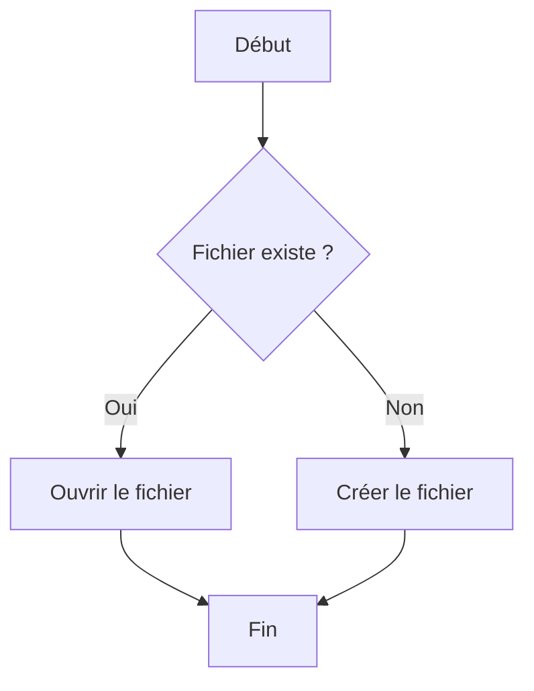
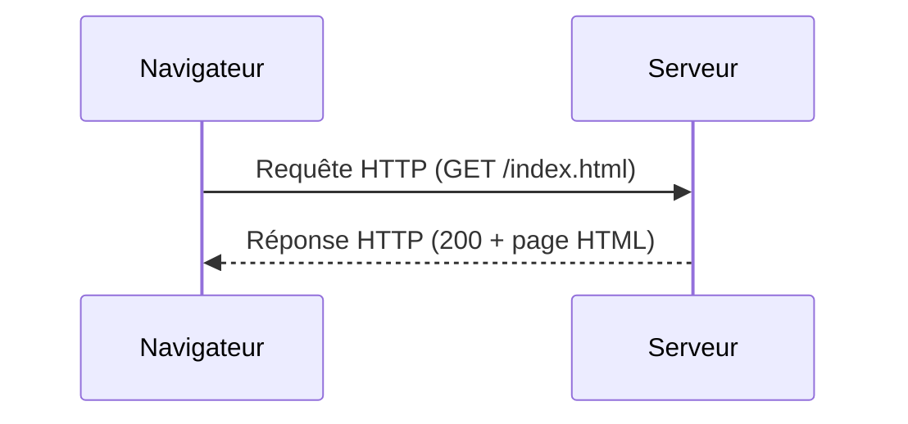
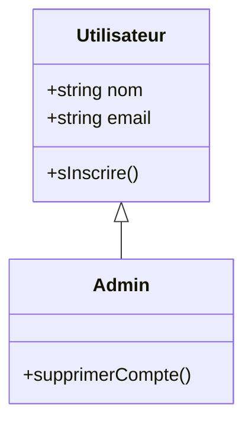
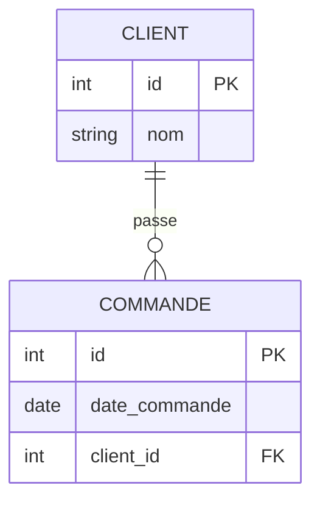

## Résumé
Markdown est un langage de **balisage léger** : on écrit du texte brut avec quelques symboles (`#`, `*`, `-`…) et un logiciel les transforme en titres, listes, liens, tableaux, schémas. Un fichier Markdown a l'extension `.md`. C'est le format utilisé pour les fiches Obsidian, les `README.md` GitHub et la documentation de projet.

---

## Définitions clés

| Terme                   | Définition                                                                                                                                           |
| ----------------------- | ---------------------------------------------------------------------------------------------------------------------------------------------------- |
| **Langage de balisage** | Texte + symboles qui indiquent la structure et la mise en forme (titre, gras, liste). Ce n'est pas un langage de programmation : il ne calcule rien. |
| **Texte brut**          | Fichier sans mise en forme cachée. Lisible dans n'importe quel éditeur.                                                                              |
| **`.md`**               | Extension d'un fichier Markdown (ex. `README.md`).                                                                                                   |
| **Rendu**               | Affichage final mis en forme (titres gros, gras, etc.), obtenu à partir du texte brut.                                                               |
| **Syntaxe**             | Ensemble des règles d'écriture (quel symbole fait quoi).                                                                                             |
| **Bloc de code**        | Zone de texte affichée telle quelle, en police à largeur fixe.                                                                                       |
| **Mermaid**             | Langage de description de schémas, intégré à Markdown (diagrammes générés à partir de texte).                                                        |
| **README**              | Fichier `README.md` à la racine d'un projet : présentation, installation, utilisation.                                                               |

---

## Pourquoi utiliser Markdown
- **Simple** : une dizaine de symboles à retenir.
- **Portable** : du texte brut s'ouvre partout (VSCode, Obsidian, GitHub, terminal).
- **Compatible Git** : le texte brut permet de comparer les versions ligne par ligne (`git diff`). Un `.docx` ne le permet pas.
- **Durable** : aucun logiciel propriétaire requis.
- **Standard du métier** : README, wiki, documentation technique, tickets GitHub.
- **Rapide** : pas de menus, tout se fait au clavier.

---

## Fonctionnement

````mermaid
flowchart LR
    A["Fichier fiche.md<br/>(texte brut + symboles)"] --> B["Interpréteur Markdown<br/>(Obsidian, GitHub, VSCode)"]
    B --> C["Rendu mis en forme<br/>(titres, listes, tableaux)"]
````

Les symboles sont lus par l'interpréteur, puis affichés sous forme de mise en forme. Le fichier source reste inchangé.

---

## Procédure : créer un fichier Markdown (Ubuntu + VSCode)

1. Ouvrir un terminal (`Ctrl + Alt + T`).
2. Créer un dossier de travail et s'y placer :
   ````bash
   mkdir -p ~/formation/markdown   # -p : crée aussi les dossiers parents si besoin
   cd ~/formation/markdown          # cd : change de dossier
   ````
3. Créer le fichier vide :
   ````bash
   touch fiche.md                   # touch : crée un fichier vide
   ````
4. Ouvrir le dossier dans VSCode :
   ````bash
   code .                           # le point = dossier courant
   ````
5. Ouvrir `fiche.md` et écrire le contenu.
6. Afficher l'aperçu : `Ctrl + Shift + V` (aperçu plein écran) ou `Ctrl + K` puis `V` (aperçu à côté).
7. Enregistrer : `Ctrl + S`.

**Dans Obsidian** : créer une note (`Ctrl + N`), écrire. Le mode **Lecture** affiche le rendu (`Ctrl + E` pour basculer entre édition et lecture).

> Erreur fréquente : oublier l'extension `.md` → le fichier n'est pas reconnu comme Markdown.

---

## Syntaxe :

### Titres
On met des `#` suivis **d'un espace**. Plus il y a de `#`, plus le niveau est bas.

````markdown
# Titre niveau 1
## Titre niveau 2
### Titre niveau 3
#### Titre niveau 4
````

- Un seul `#` (niveau 1) par fichier : c'est le titre du document.
- Ne pas sauter de niveau (pas de `###` juste après `#`).
- `#Titre` (sans espace) ne fonctionne pas.

### Paragraphes et sauts de ligne
- Un paragraphe = du texte séparé du suivant par **une ligne vide**.
- Saut de ligne simple : terminer la ligne par **deux espaces** ou par `\`.
- Ligne de séparation : `---` sur une ligne seule.

````markdown
Premier paragraphe.

Deuxième paragraphe.

---
````

### Mise en forme du texte

| Effet | Syntaxe | Rendu |
|---|---|---|
| Italique | `*texte*` ou `_texte_` | *texte* |
| Gras | `**texte**` | **texte** |
| Gras + italique | `***texte***` | ***texte*** |
| Barré | `~~texte~~` | ~~texte~~ |
| Code en ligne | `` `code` `` | `code` |
| Surligné (Obsidian) | `==texte==` | ==texte== |

### Listes

````markdown
- Élément (liste à puces)
- Autre élément
    - Sous-élément (indenter de 4 espaces ou 1 tabulation)

1. Première étape (liste numérotée)
2. Deuxième étape
3. Troisième étape

- [ ] Tâche à faire (case à cocher)
- [x] Tâche faite
````

- `-`, `*` ou `+` fonctionnent pour les puces. Choisir un seul symbole et s'y tenir : `-`.
- Une liste numérotée se renumérote automatiquement au rendu.

###  Liens

````markdown
[texte affiché](https://github.com)           ← lien externe
[texte affiché](https://github.com "titre")   ← avec infobulle
<https://github.com>                          ← lien brut cliquable
[[Nom d'une autre note]]                      ← lien interne Obsidian (wikilink)
[[Nom de la note|texte affiché]]              ← lien interne avec texte personnalisé
[[Note#Titre de section]]                     ← lien vers une section
````

### Images

````markdown
    ← standard Markdown
![[schema.png]]                           ← syntaxe Obsidian
![[schema.png|300]]                       ← largeur 300 px (Obsidian)
````

- Le **texte alternatif** (entre `[]`) décrit l'image : il est lu par les lecteurs d'écran (accessibilité, RGAA) et affiché si l'image ne charge pas. Toujours le renseigner.
- Chemin relatif : `images/schema.png` = dossier `images` situé à côté du fichier `.md`.
- ⚠️ Éviter les espaces et accents dans les noms de fichiers d'images.

### Citations

````markdown
> Texte cité
> sur plusieurs lignes
````

**Callouts Obsidian** (encadrés colorés) :

````markdown
> [!note] Titre
> Contenu de la note.

> [!warning] Attention
> Point de vigilance.

> [!tip] Astuce
> Conseil.
````

Types utiles : `note`, `info`, `tip`, `warning`, `danger`, `example`, `question`.

###  Code

**Code en ligne** : entouré d'un accent grave `` ` ``.

**Bloc de code** : entouré de trois accents graves ```` ``` ````, avec le **nom du langage** juste après l'ouverture (coloration syntaxique).

````markdown
```javascript
// Affiche un message dans la console
console.log("Bonjour");
```
````

Langages courants : `bash`, `html`, `css`, `javascript`, `php`, `sql`, `json`, `mermaid`.

> ⚠️ Accent grave sur clavier AZERTY Linux : `AltGr + 7`. Le taper deux fois de suite pour obtenir `` ` ``, selon la configuration, ou le taper puis espace.

### Tableaux

````markdown
| Colonne 1 | Colonne 2 | Colonne 3 |
|-----------|:---------:|----------:|
| gauche    | centré    | droite    |
| a         | b         | c         |
````

- La 2ᵉ ligne (`|---|---|`) est **obligatoire**.
- Alignement : `:---` gauche, `:---:` centré, `---:` droite.
- Les `|` n'ont pas besoin d'être alignés visuellement dans le texte source.
- Pour écrire un `|` dans une cellule : `\|`.

### Échappement
Pour afficher un symbole Markdown tel quel, le faire précéder d'un antislash `\` :

````markdown
\*pas en italique\*
\# pas un titre
````

### Spécifique Obsidian

| Fonction | Syntaxe |
|---|---|
| Tag | `#html`, `#css`, `#linux` (sans espace) |
| Propriétés (frontmatter YAML) | bloc `---` en tout début de fichier |
| Lien interne | `[[nom]]` |
| Intégrer une note | `![[nom]]` |
| Commentaire invisible | `%%commentaire%%` |
| Formule mathématique | `$E = mc^2$` |

Exemple de propriétés en tête de fiche :

````markdown
---
tags: [markdown, obsidian]
date: 2026-11-12
---
````

---

## Mermaid : créer des schémas

### 6.1 Principe
Mermaid permet de dessiner un schéma **en écrivant du texte**. Le schéma se modifie en changeant le texte, et reste versionnable avec Git.

### Procédure
1. Écrire un bloc de code avec le langage `mermaid`.
2. Indiquer le **type de schéma** à la première ligne.
3. Décrire les éléments et leurs liens.
4. Passer en mode Lecture (Obsidian) ou aperçu (VSCode, avec l'extension *Markdown Preview Mermaid Support*) pour vérifier.

Structure du bloc :

````markdown
```mermaid
type_de_schema
    contenu
```
````

### Organigramme (`flowchart`)
Types de sens : `TD` (haut → bas), `LR` (gauche → droite).

````markdown

````

Rendu :

````mermaid
flowchart TD
    A[Début] --> B{Fichier existe ?}
    B -->|Oui| C[Ouvrir le fichier]
    B -->|Non| D[Créer le fichier]
    C --> E[Fin]
    D --> E
````

**Formes des blocs :**

| Syntaxe | Forme | Usage |
|---|---|---|
| `A[texte]` | rectangle | étape |
| `A(texte)` | rectangle arrondi | étape |
| `A([texte])` | stade | début / fin |
| `A{texte}` | losange | condition / décision |
| `A[(texte)]` | cylindre | base de données |
| `A((texte))` | cercle | point de jonction |

**Flèches :**

| Syntaxe | Rendu |
|---|---|
| `A --> B` | flèche |
| `A --- B` | ligne sans flèche |
| `A -->|texte| B` | flèche avec étiquette |
| `A -.-> B` | flèche pointillée |
| `A ==> B` | flèche épaisse |

### 6.4 Diagramme de séquence (`sequenceDiagram`)
Montre les échanges dans le temps entre plusieurs acteurs.

````markdown

````

Rendu :

````mermaid
sequenceDiagram
    participant N as Navigateur
    participant S as Serveur
    N->>S: Requête HTTP (GET /index.html)
    S-->>N: Réponse HTTP (200 + page HTML)
````

- `->>` : flèche pleine (envoi) ; `-->>` : flèche pointillée (réponse).

### Diagramme de classes (`classDiagram`)
Pour la POO et UML (JavaScript, PHP).

````markdown

````

Rendu :

````mermaid
classDiagram
    class Utilisateur {
        +string nom
        +string email
        +sInscrire()
    }
    class Admin {
        +supprimerCompte()
    }
    Utilisateur <|-- Admin
````

- `+` public, `-` privé.
- `<|--` : héritage (Admin hérite de Utilisateur).

### Diagramme entité-relation (`erDiagram`)
Pour la modélisation de bases de données (SQL).

````markdown

````

Rendu :

````mermaid
erDiagram
    CLIENT ||--o{ COMMANDE : passe
    CLIENT {
        int id PK
        string nom
    }
    COMMANDE {
        int id PK
        date date_commande
        int client_id FK
    }
````

Cardinalités : `||` un et un seul ; `o{` zéro ou plusieurs ; `|{` un ou plusieurs ; `o|` zéro ou un.

### Autres types utiles

| Type | Mot-clé | Usage |
|---|---|---|
| Diagramme d'états | `stateDiagram-v2` | cycles de vie (commande : créée → payée → livrée) |
| Planning | `gantt` | planification de projet |
| Chronologie | `timeline` | historique, étapes |
| Carte mentale | `mindmap` | cartes de révision |
| Graphe Git | `gitGraph` | branches et commits |
| Camembert | `pie` | répartition |

Exemple `mindmap` :

````mermaid
mindmap
  root((Markdown))
    Syntaxe
      Titres
      Listes
      Liens
    Outils
      Obsidian
      VSCode
    Mermaid
      flowchart
      sequenceDiagram
````

### Règles pour éviter les erreurs Mermaid
- Le **type de schéma** doit être sur la première ligne.
- Indenter avec des espaces, de façon cohérente.
- Pas de parenthèses ni de caractères spéciaux dans le texte d'un nœud sans guillemets : écrire `A["texte (détail)"]`.
- Identifiants de nœuds sans espaces ni accents (`etape1`, pas `étape 1`).
- Si le schéma ne s'affiche pas : relire la ligne indiquée dans le message d'erreur.

---

### Cas d'usage dans la formation
- **Obsidian** : fiches de cours, mémos, cartes mentales.
- **Git/GitHub** : `README.md` du projet, description des *pull requests* et *issues*.
- **Cahier des charges** : rédaction structurée (titres, listes, tableaux).
- **Documentation projet final** : installation, utilisation, schéma de base de données (ER), architecture MVC (flowchart).

### Modèle de README.md minimal

````markdown
# Nom du projet

Description en une phrase.

## Installation
1. Cloner le dépôt : `git clone <url>`
2. Se placer dans le dossier : `cd nom-du-projet`
3. Installer les dépendances : `npm install`

## Utilisation
Commande de lancement : `npm start`

## Technologies
- HTML / CSS / JavaScript
- PHP / MySQL

## Auteur
Prénom Nom
````

---

## Pièges courants / erreurs de débutant
- Oublier l'**espace** après `#`, `-`, `1.` → pas de rendu.
- Oublier la **ligne vide** avant une liste, un tableau ou un bloc de code.
- Ligne de séparation `|---|---|` absente dans un tableau.
- Fermer un bloc de code avec le mauvais nombre d'accents graves.
- Indenter un paragraphe de 4 espaces → il devient un bloc de code.
- Mélanger plusieurs syntaxes de puces (`-`, `*`, `+`) dans le même document.
- Utiliser plusieurs titres de niveau 1.
- Images sans texte alternatif.
- Liens `[[...]]` : spécifiques à Obsidian, non interprétés par GitHub.


---

## Aide-mémoire

| Je veux… | J'écris |
|---|---|
| Un titre | `## Titre` |
| Du gras | `**texte**` |
| De l'italique | `*texte*` |
| Une puce | `- élément` |
| Une liste numérotée | `1. étape` |
| Une case à cocher | `- [ ] tâche` |
| Un lien | `[texte](url)` |
| Une image | `` |
| Du code en ligne | `` `code` `` |
| Un bloc de code | ```` ```langage ```` … ```` ``` ```` |
| Une citation | `> texte` |
| Un tableau | `\| a \| b \|` + ligne `\|---\|---\|` |
| Un séparateur | `---` |
| Un schéma | ```` ```mermaid ```` |
| Un lien interne Obsidian | `[[note]]` |

---

##  Liens internes
[[Git et GitHub]] · [[Linux et commandes de base]] · [[VSCode]] · [[Cahier des charges]] · [[UML et POO]] · [[Modélisation base de données]]

---

