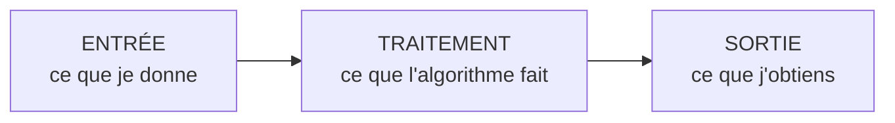
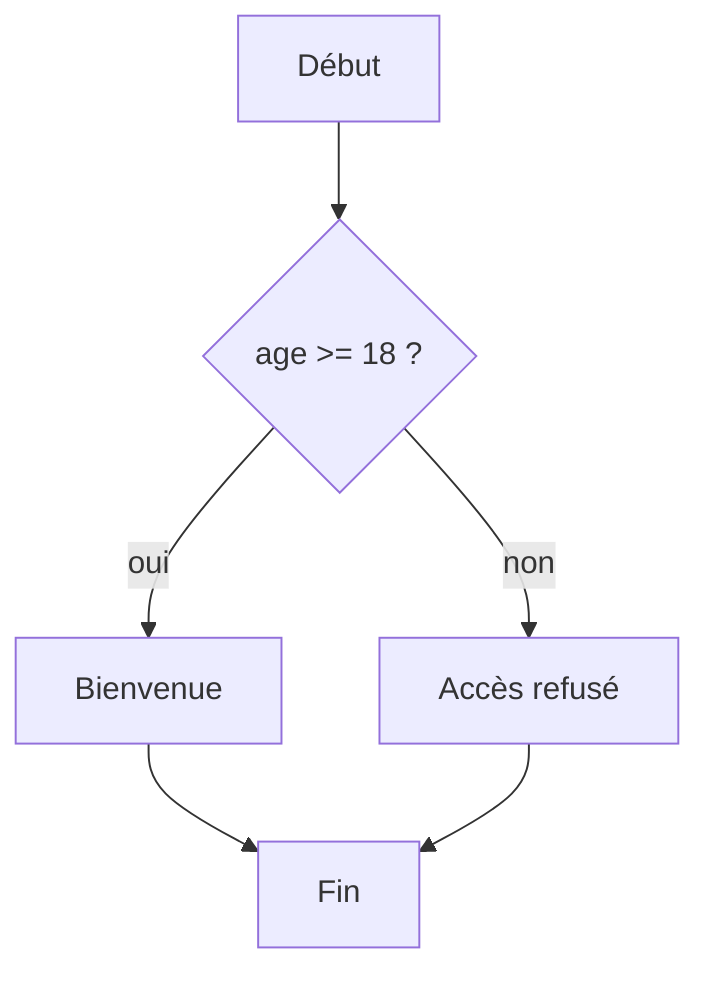
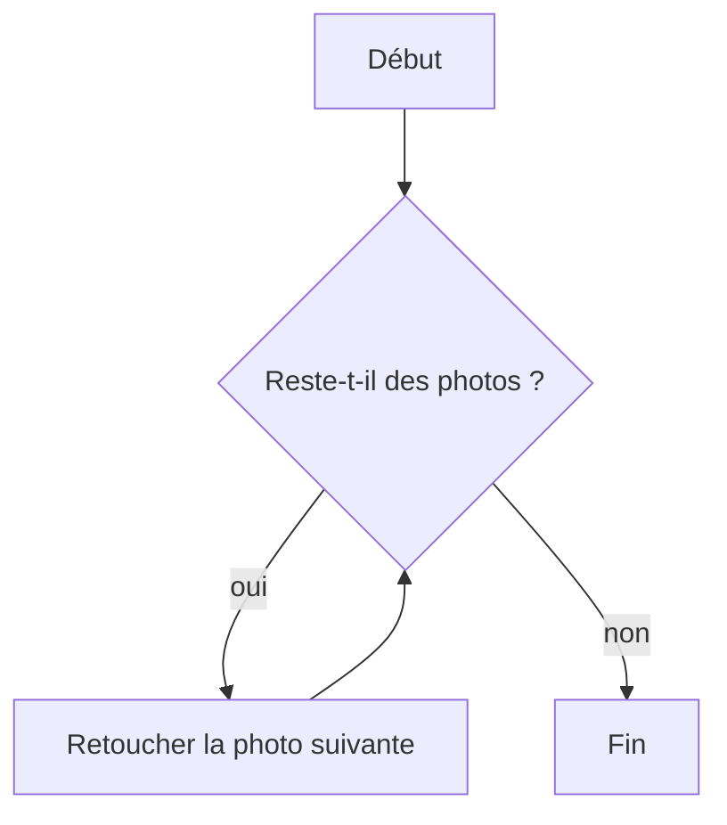

---
tags:
  - algo
  - bases
  - vulgarisation
cours: Algorithmique - notions de base
---

# Les algorithmes : comprendre simplement

#algo #logique #bases

## Résumé

Un **algorithme** est une **recette** : une suite d'étapes précises, dans un ordre précis, pour obtenir un résultat. Il n'est pas lié à un langage : je peux l'écrire en français, le dessiner, puis le traduire en JavaScript. Tout programme, du plus simple au plus gros, est fait d'algorithmes.

---

## 1. Un algorithme dans la vie de tous les jours

### Exemple : faire un café

1. Remplir le réservoir d'eau.
2. Mettre une dosette.
3. Appuyer sur le bouton.
4. **Si** la tasse est pleine, **alors** retirer la tasse. **Sinon**, attendre.
5. Boire.

### Exemple : trier des candidatures (RH)

1. Ouvrir une candidature.
2. **Si** le CV correspond au poste, **alors** convoquer à un entretien. **Sinon**, envoyer un refus.
3. **Recommencer** avec la candidature suivante, **tant qu'il en reste**.

### Exemple : retoucher des photos

1. Ouvrir la photo.
2. **Si** elle est sous-exposée, **alors** augmenter l'exposition.
3. Exporter en JPEG.
4. **Répéter** pour toutes les photos du dossier.

Ces trois exemples contiennent déjà tout ce qu'il y a à savoir : des **étapes dans l'ordre**, des **choix** et des **répétitions**.

---

## 2. Définitions clés

| Terme            | Définition simple                                                                      |
| ---------------- | -------------------------------------------------------------------------------------- |
| **Algorithme**   | Suite d'instructions précises, dans l'ordre, qui résout un problème                    |
| **Instruction**  | Une seule action à faire (une ligne = une instruction)                                 |
| **Entrée**       | Ce que l'algorithme reçoit au départ (l'âge saisi, les ingrédients)                    |
| **Traitement**   | Ce qu'il fait avec (calculs, comparaisons)                                             |
| **Sortie**       | Le résultat qu'il donne (un message, un prix)                                          |
| **Variable**     | Une boîte étiquetée qui garde une valeur (voir [[Fiche - Algo et JavaScript (bases)]]) |
| **Condition**    | Un choix : « si... sinon... »                                                          |
| **Boucle**       | Une répétition : « tant que... » ou « pour chaque... »                                 |
| **Fonction**     | Un bout d'algorithme avec un nom, que je peux réutiliser                               |
| **Pseudo-code**  | L'algorithme écrit en français, sans langage de programmation                          |
| **Organigramme** | L'algorithme dessiné avec des formes et des flèches                                    |

---

## 3. Le schéma de base : entrée, traitement, sortie



Exemple : un **distributeur de boissons**.

- Entrée : la pièce + le choix du produit.
- Traitement : vérifier le montant, rendre la monnaie.
- Sortie : la boisson.

---

## 4. Les 3 briques de tout algorithme

### Brique 1 : la séquence (étapes dans l'ordre)

Les instructions s'exécutent **de haut en bas**, une par une. L'ordre compte : mettre la dosette **avant** d'appuyer sur le bouton.

```js
let prix = 30;
let reduction = 0.9;
let total = prix * reduction;   // 1. on calcule
alert(total);                   // 2. puis on affiche
```

### Brique 2 : la condition (je choisis)



```js
if (age >= 18) {
  alert("Bienvenue");
} else {
  alert("Accès refusé");
}
```

### Brique 3 : la boucle (je répète)



```js
// Exemple : afficher les nombres de 1 à 3
for (let i = 1; i <= 3; i++) {
  console.log(i);
}
```

(Les boucles seront étudiées plus tard dans la formation : ici je retiens simplement l'idée.)
### Dans cette partie, tu as mentionné que tu retiens juste l'idée mais tu devrais quand meme préciser qu'il y a 2 types de boucles : Celle ou l'on connait le nombre d'itérations (for ....) Et celle ou on connait pas le nbr d'it (while ....)

---

## 5. Mode d'emploi : écrire un algorithme

1. **Comprendre le problème** : que doit-on obtenir ? Écrire la phrase en une ligne.
2. **Lister les entrées** (ce que je reçois) et la **sortie** (ce que je dois donner).
3. **Découper** le problème en petites étapes.
4. **Écrire en pseudo-code** (en français, sans me soucier de la syntaxe).
5. **Chercher les cas particuliers** : valeur vide, nombre négatif, aucun choix fait.
6. **Tester à la main** avec quelques exemples (un cas normal, un cas limite).
7. **Traduire en JavaScript**, puis tester dans la console.

### Exemple complet : le prix d'un panier

**Problème** : afficher le prix d'un article, avec 10 % de réduction si le code promo est valide.

**Entrées** : l'article choisi, le code promo. **Sortie** : le prix final.

**Pseudo-code** :

```
DÉBUT
  SI article = "one" ALORS prix = 30
  SINON SI article = "two" ALORS prix = 50
  SINON afficher "Choisis un article" ET ARRÊTER
  SI code promo valide ALORS prix = prix x 0,9
  AFFICHER prix
FIN
```

**Traduction JavaScript** :

```js
const VALID_PROMOTION_CODE = "10POUR100";

function cartValue() {
  let selectedArticle = document.getElementById("articles").value;
  let price;

  if (selectedArticle === "one") price = 30;
  else if (selectedArticle === "two") price = 50;
  else {
    alert("Vous devez choisir un article");
    return;                       // on arrête ici
  }

  let promotion = document.getElementById("promotion").value;
  if (promotion === VALID_PROMOTION_CODE) price *= 0.9;

  alert("La valeur de votre panier est : " + price + " euros");
}
```

Le pseudo-code et le JavaScript ont **la même structure** : seule l'écriture change.

---

## 6. Ce qui fait un bon algorithme

| Qualité | Signification |
|---|---|
| **Correct** | Il donne le bon résultat dans **tous** les cas, pas seulement le cas facile |
| **Précis** | Chaque étape est sans ambiguïté (l'ordinateur ne devine rien) |
| **Fini** | Il se termine un jour (pas de boucle infinie) |
| **Lisible** | Noms clairs, commentaires utiles |
| **DRY** | *Don't Repeat Yourself* : je n'écris pas deux fois la même chose |

### Refactoriser

**Refactoriser** = réécrire un algorithme qui marche pour le rendre plus propre, **sans changer son résultat** : repérer les répétitions, les regrouper, nommer les petites étapes.

---

## Pièges courants 

- Écrire du code **avant** d'avoir compris le problème : je commence au brouillon, en français.
- Oublier les **cas particuliers** (aucune case cochée, champ vide).
- **L'ordre** des instructions : un calcul fait avant que la variable existe ne marche pas.
- Une condition qui ne couvre pas tous les cas (pas de `else` final).
- Confondre `=` (affecter) et `===` (comparer).
- Une **boucle infinie** : la condition de sortie n'est jamais atteinte.
- Ne pas **tester à la main** : je simule l'algorithme avec un exemple, ligne par ligne.

