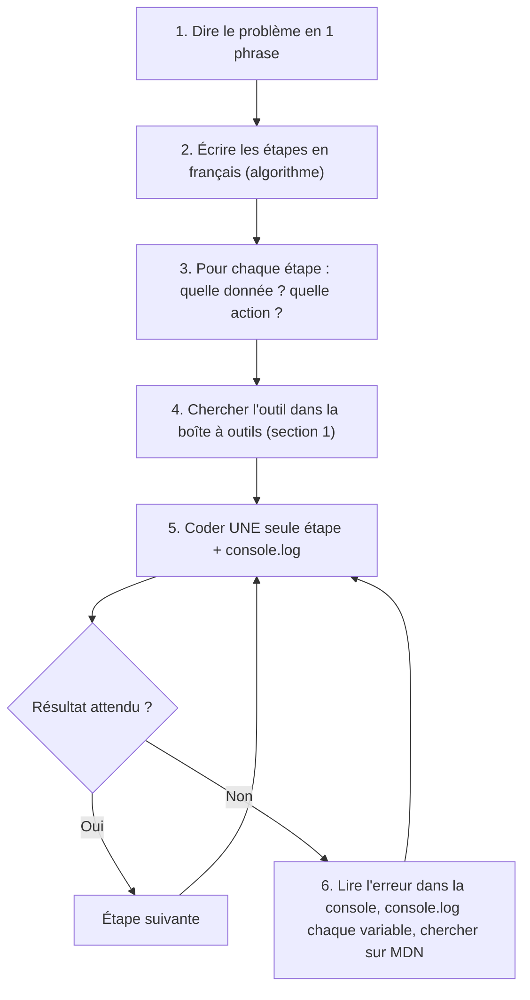
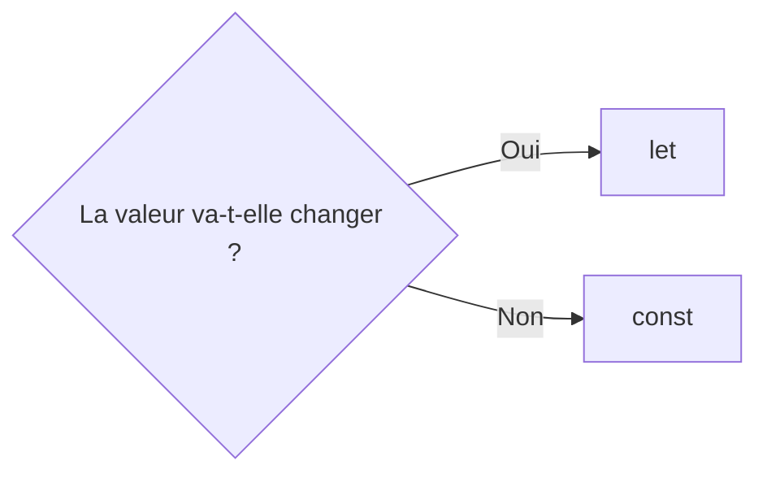
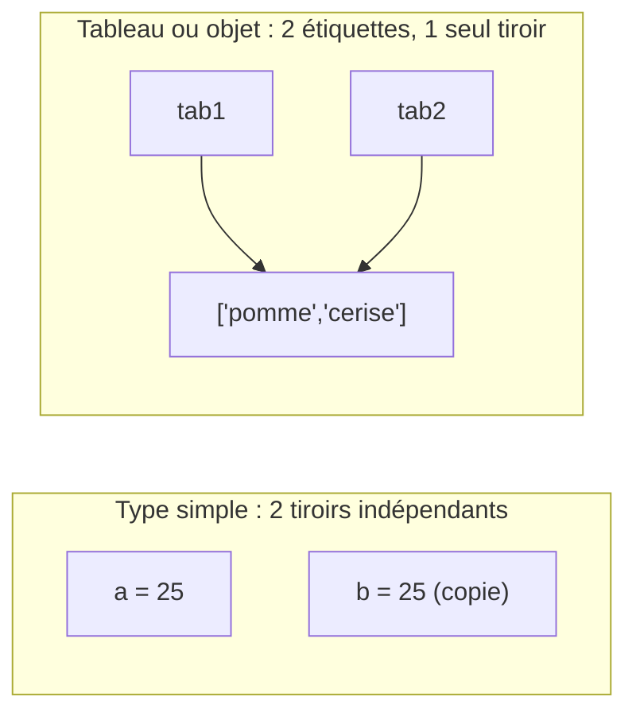
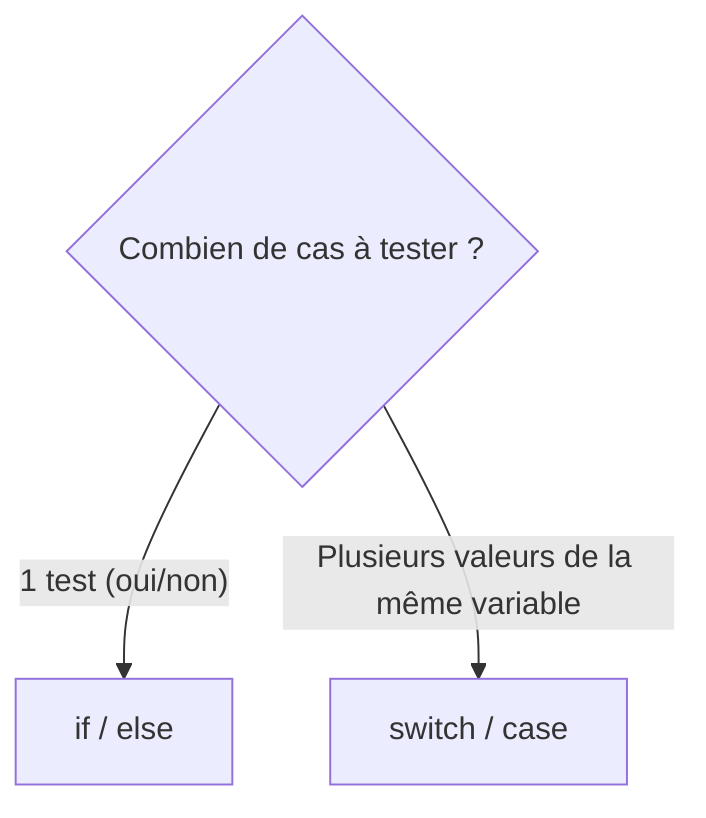
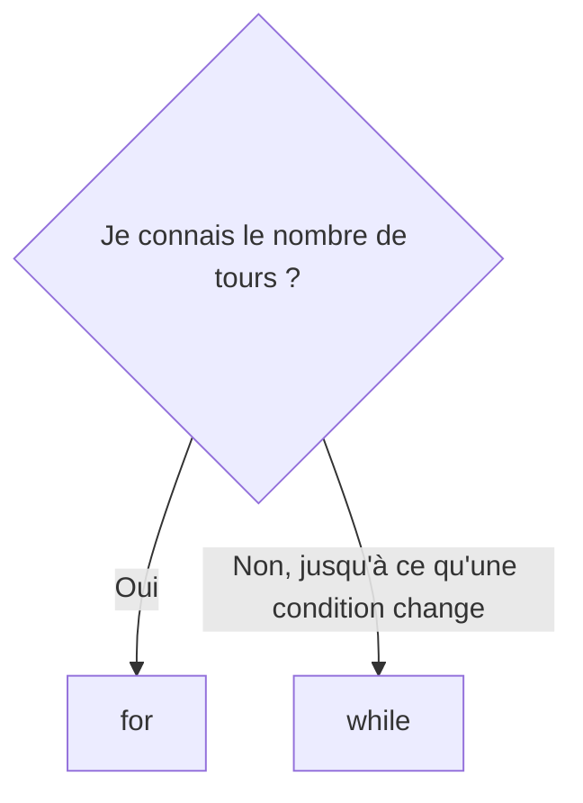

# JavaScript : bases et logique

> **Résumé** : en JavaScript, je range des données dans des **variables**, je les regroupe dans des **objets** et des **tableaux**, puis je décide quoi faire avec des **conditions** et je répète avec des **boucles**. Avant d'écrire du code, j'écris les étapes en français : c'est l'**algorithme**. Le code n'est que la traduction de ces étapes.

---

## 0. Quand je bloque : la méthode en 6 étapes



**Procédure détaillée**
1. **Phrase-problème** : « Je veux compter combien de photos sont en noir et blanc. »
2. **Algorithme en français** avec les mots-clés : `Si` / `Alors` / `Sinon` / `Répéter` / `Tant que` / `Pour chaque`.
3. **Pour chaque étape, je me pose 2 questions** :
   - *Quelle donnée dois-je garder en mémoire ?* → variable, objet ou tableau.
   - *Quelle action dois-je faire dessus ?* → opérateur, méthode, condition ou boucle.
4. **Je cherche dans la boîte à outils** (section 1) la ligne qui correspond à ce que je veux faire.
5. **Je code une seule étape**, puis `console.log(...)`, puis je teste. Je ne continue pas tant que cette étape ne marche pas.
6. **Si ça plante** : je lis le message rouge de la console (il donne le fichier et le numéro de ligne), je mets un `console.log` sur chaque variable pour voir ce qu'elle contient vraiment, et je cherche sur [MDN](https://developer.mozilla.org/fr/).

> Règle d'or : **tester très souvent**, après chaque petite étape. Une erreur est facile à trouver quand elle vient des 3 dernières lignes, impossible quand elle vient des 50 dernières.

---

## 1. Boîte à outils : « Je veux… → j'écris… »

| Je veux… | J'écris | Exemple |
|---|---|---|
| Stocker une valeur **qui va changer** | `let` | `let score = 0` |
| Stocker une valeur **qui ne changera pas** (ou un tableau/objet) | `const` | `const auteur = "Pauline"` |
| **Voir** le contenu d'une variable | `console.log(variable)` | `console.log(score)` |
| **Demander** un texte à l'utilisateur | `prompt("question")` | `let rep = prompt("Ton prénom ?")` |
| Transformer du texte en **nombre** | `Number("12")` | `Number("150")` donne `150` |
| **Coller** deux textes | `+` (concaténation) | `"Bonjour " + prenom` |
| **Ajouter** à un nombre | `+=` ou `++` | `score += 10` / `score++` |
| Regrouper **plusieurs infos sur UNE chose** | objet `{ }` | `{ titre: "Plage", annee: 2024 }` |
| **Lire** une info d'un objet | `objet.propriete` | `photo.titre` |
| **Ajouter** une info à un objet | `objet.nouvelle = ...` | `photo.lieu = "Vannes"` |
| Faire une **liste** de choses semblables | tableau `[ ]` | `["a", "b", "c"]` |
| Lire une **case** du tableau | `tableau[numero]` | `liste[0]` (la 1re case est la n°0) |
| Connaître la **taille** du tableau | `tableau.length` | `liste.length` |
| **Ajouter** à la fin du tableau | `tableau.push(valeur)` | `liste.push("d")` |
| **Retirer** le dernier élément | `tableau.pop()` | `liste.pop()` |
| **Copier** un tableau (indépendant) | `[...tableau]` | `const copie = [...liste]` |
| **Tester** une chose (oui/non) | `if (...) { } else { }` | voir section 7 |
| Tester **plusieurs valeurs possibles** | `switch / case / break` | voir section 7 |
| Répéter **un nombre de fois connu** | `for` | voir section 8 |
| Répéter **jusqu'à ce que** ça change | `while` | voir section 8 |
| **Commenter** mon code | `// mon commentaire` | `// ici je calcule le score` |

---

## 2. Variables

**Idée simple** : la mémoire de l'ordinateur est une grande armoire de tiroirs. Une **variable** est un tiroir, son **nom** est l'étiquette, sa **valeur** est ce que je range dedans.

```js
let age = 42          // je crée (déclare) la variable age
age = 43              // je change la valeur : PAS de let la 2e fois

const prenom = "Pauline"   // constante : impossible à changer
// prenom = "Léa"          // ERREUR : JavaScript refuse
```

### let ou const ?

- Je me pose la question **à chaque fois** que je crée une variable.
- `var` est **obsolète** : je ne l'utilise pas, mais j'en verrai dans de vieux codes.
- Le `;` en fin de ligne est facultatif : je choisis une fois et je m'y tiens pour tout le projet.

### Les 3 types basiques
| Type | C'est | Exemple |
|---|---|---|
| `string` | du texte, entre guillemets `" "` ou `' '` | `"Bonjour"` |
| `number` | un nombre (sans guillemets) | `42` |
| `boolean` | vrai ou faux | `true` / `false` |

### Bien nommer
- Le nom décrit **précisément** le contenu : `nombrePhotos`, pas `x`.
- Écriture en **camelCase** : `nomUtilisateur`, `totalEntrees`.
- Pas d'espace, pas d'accent dans le nom, jamais de nombre au début.

---

## 3. Opérateurs : modifier une valeur

### Chiffres
```js
let total = 10 + 5      // + - * /
let places = 150
places = places + 10    // je lis : "places vaut places plus 10"
places += 10            // raccourci identique (aussi -=  *=  /=)
places++                // +1 (incrémentation)
```
⚠️ `places = 10` **écrase** l'ancienne valeur au lieu d'ajouter.

### Texte : la concaténation
```js
const debut = "Mon nom est Bond"
const fin = ", James Bond."
const phrase = debut + fin     // "Mon nom est Bond, James Bond."
const message = "J'ai " + 3 + " photos"   // on peut coller du texte et une variable
```

### Le piège texte / nombre
```js
let a = "150"      // guillemets = TEXTE
a += "10"          // résultat : "15010" (collé, pas additionné !)

let b = Number("150")
b += Number("10")  // résultat : 160
```
> Réflexe : si un résultat est bizarre (`"15010"` au lieu de `160`), je vérifie les **types** (guillemets ?).

### Comparer (le résultat est un booléen)
| Symbole | Signifie |
|---|---|
| `===` | strictement égal |
| `!==` | différent de |
| `<` `<=` | inférieur / inférieur ou égal |
| `>` `>=` | supérieur / supérieur ou égal |

⚠️ **`=`** range une valeur (`a = 42`). **`===`** compare (`a === 42`). Je n'utilise pas `==` ni `!=` (ils comparent mal les types).

---

## 4. Objets `{ }` : plusieurs infos sur une même chose

**Idée simple** : une fiche d'identité. Chaque ligne a un **nom** (propriété) et une **valeur**.

```js
const photo = {
    titre: "Brume sur le golfe",   // propriété: valeur
    annee: 2024,                   // les propriétés sont séparées par des virgules
    noirEtBlanc: true
}

photo.lieu = "Vannes"        // AJOUTER une propriété (nom + point + nouveau nom)
console.log(photo.titre)     // LIRE une propriété : "Brume sur le golfe"
const titre = photo.titre    // je la range dans une variable
```
- Accolades `{ }` pour l'objet, **deux-points** entre le nom et la valeur, **virgule** entre les propriétés.
- Pas de virgule après la dernière propriété (bonne habitude).

---

## 5. Tableaux `[ ]` : une liste ordonnée

**Idée simple** : une rangée de casilles **numérotées à partir de 0**.

```js
const albums = ["Bretagne", "Portraits", "Mariages"]
//                 case 0       case 1       case 2

console.log(albums[0])       // "Bretagne"
console.log(albums.length)   // 3  (propriété : PAS de parenthèses)

albums.push("Voyages")       // ajoute à la FIN → 4 éléments
albums.pop()                 // retire le DERNIER (parenthèses vides)
```
- Dernière case = `tableau.length - 1`.
- **Propriété** (`length`) : sans parenthèses. **Méthode** (`push`, `pop`) : avec parenthèses.
- D'autres méthodes existent (`splice`, `sort`…) : je les cherche sur MDN quand j'en ai besoin.

### Copie par valeur ou par référence

```js
// Type simple : copie par VALEUR
let a = 25
let b = a
b = 30             // a vaut toujours 25

// Tableau : copie par RÉFÉRENCE (même contenu partagé)
const t1 = ["pomme", "cerise"]
const t2 = t1
t2.push("poire")   // t1 contient AUSSI "poire" !

// Vraie copie indépendante : spread operator
const t3 = [...t1] // t3 est un nouveau tableau
```
> Pourquoi `const` pour un tableau qui change ? Ce qui est constant, c'est l'**emplacement** en mémoire, pas le contenu.

---

## 6. De l'idée au code : l'algorithme

Un **algorithme** = la liste des étapes pour résoudre un problème, écrite en français **avant** de coder.

**Exemple (mon propre cas)** : vérifier un code d'accès à une galerie privée.
```
1. Demander le code à l'utilisateur
2. SI le code est égal au bon code
      ALORS afficher "Bienvenue"
      SINON afficher "Accès refusé"
```
Traduction ligne par ligne :
```js
const bonCode = "photo2026"                              // donnée fixe → const
const codeSaisi = prompt("Code d'accès ?")               // étape 1 → prompt
if (codeSaisi === bonCode) {                             // SI → if + comparaison ===
    console.log("Bienvenue")                             // ALORS → premier bloc
} else {                                                 // SINON → else
    console.log("Accès refusé")
}
```

| Mot de mon algorithme | Outil JavaScript |
|---|---|
| Si / Alors / Sinon | `if / else` |
| Selon la valeur (plusieurs cas) | `switch / case` |
| Répéter N fois | `for` |
| Tant que / jusqu'à ce que | `while` |
| Pour chaque élément de la liste | `for` + `tableau[i]` |
| Garder en mémoire | `let` / `const` |
| Demander à l'utilisateur | `prompt` |
| Afficher / vérifier | `console.log` |

### Les blocs de code `{ }`
Un **bloc** regroupe des lignes qui vont ensemble (dans un `if`, un `for`, une fonction). **Ce qui est dans les accolades dépend de la structure qui le précède.** L'emplacement d'une ligne (dedans ou dehors) change complètement le résultat.

---

## 7. Conditions

### `if / else` : un seul test
```js
if (condition) {
    // exécuté si la condition est VRAIE
} else {
    // exécuté si elle est FAUSSE (le else est facultatif)
}
```
La condition est soit un **booléen** (`if (estConnecte)`), soit une **comparaison** (`if (age >= 18)`).

### `switch / case` : plusieurs valeurs possibles
À utiliser quand j'aurais plein de `if` imbriqués sur **la même variable**.
```js
switch (format) {            // la variable à tester
    case "portrait":
        console.log("Orientation verticale")
        break                // STOP : sinon le case suivant s'exécute aussi
    case "paysage":
        console.log("Orientation horizontale")
        break
    default:                 // tous les autres cas
        console.log("Format inconnu")
}
```

### Choisir


---

## 8. Boucles : répéter du code

### `for` : je sais combien de tours
```js
for (let i = 0; i < 3; i++) {
//   1) départ    2) tant que   3) après chaque tour
    console.log(i)           // exécuté à chaque tour : 0, puis 1, puis 2
}
```
- **1** : `let i = 0` → le compteur démarre à 0.
- **2** : `i < 3` → la boucle continue tant que c'est vrai.
- **3** : `i++` → le compteur augmente de 1 à chaque tour.
- `i` = « indice » (nom habituel du compteur).

**Parcourir un tableau** : l'indice `i` sert de numéro de case.
```js
const albums = ["Bretagne", "Portraits", "Mariages"]
for (let i = 0; i < albums.length; i++) {
    console.log(albums[i])   // albums[0], puis albums[1], puis albums[2]
}
```
`albums.length` évite de compter à la main : la boucle s'adapte toute seule à la taille.

### `while` : je ne sais pas combien de tours
```js
let i = 0                    // je déclare le compteur AVANT la boucle
while (i < 3) {
    console.log(i)
    i++                      // OBLIGATOIRE : sinon boucle infinie
}
```

### Choisir


### Où placer mes lignes ?
- **Dans** les accolades de la boucle : répété à chaque tour.
- **Avant** la boucle : fait une seule fois (ex. `let score = 0`).
- **Après** la boucle : fait une seule fois à la fin (ex. afficher le score final).

---

## 9. Mettre en place mon fichier JavaScript

1. Créer un **dossier** de projet.
2. Dedans, créer `index.html` et `script.js`.
3. Dans `index.html`, relier le JS avec cette ligne dans le `<head>` :
```html
<script src="script.js"></script>
```
4. Dans `script.js` : `console.log("Hello World")`.
5. Ouvrir `index.html` dans le navigateur → **clic droit > Inspecter > onglet Console**.
6. Je modifie, j'enregistre (`Ctrl+S`), je recharge la page (`F5`) et je regarde la console.

La page est vide : c'est normal, `console.log` écrit dans la console, pas dans la page.
L'erreur rouge `favicon.ico` est sans importance.

---

## 10. Pièges courants et erreurs de débutant

| Symptôme | Cause probable | Réflexe |
|---|---|---|
| `"15010"` au lieu de `160` | des guillemets : texte, pas nombre | enlever les guillemets ou `Number()` |
| Rien ne s'affiche | mauvais fichier, `<script src>` oublié, ou console fermée | vérifier le lien, ouvrir la console |
| Erreur « Assignment to constant variable » | `const` modifié | passer en `let` |
| `undefined` | case ou propriété qui n'existe pas | vérifier l'indice (commence à 0) et l'orthographe |
| Le `if` marche toujours / jamais | `=` au lieu de `===` | relire les symboles |
| Le switch exécute plusieurs cas | `break` oublié | ajouter `break` |
| Le navigateur se fige | boucle infinie (compteur jamais incrémenté) | vérifier `i++` et la condition d'arrêt |
| Mon tableau change tout seul | copie par référence | utiliser `[...tableau]` |
| Erreur de nom | majuscule/minuscule (`monAge` ≠ `monage`) | relire le nom exact |
| Dernier élément non traité / en trop | `<` vs `<=` dans le `for` | pour un tableau : `i < tableau.length` |

---

## 11. Mémo express

```js
let x = 1;  const y = 2;                 // variables
console.log(x);  prompt("question");     // voir / demander
a + b;  a += 1;  a++;                    // calculs et collage de texte
Number("12");                            // texte → nombre
a === b;  a !== b;  a < b;  a >= b;      // comparer
const obj = { cle: valeur };  obj.cle;   // objet
const tab = [v0, v1];  tab[0];  tab.length;  tab.push(v);  tab.pop();  [...tab];
if (test) { } else { }                   // condition
switch (v) { case "a": ...; break; default: ... }
for (let i = 0; i < n; i++) { }          // boucle à nombre connu
while (test) { }                         // boucle conditionnelle
```

**Les 5 réflexes**
1. Étapes en français **avant** le code.
2. Une étape à la fois, un `console.log` à chaque fois.
3. `let` si ça change, `const` sinon.
4. `===` pour comparer, `=` pour ranger.
5. Un message rouge dans la console, c'est un indice, pas un échec.

---

## 12. Auto-test

1. Je veux compter combien de photos sont dans un tableau `photos`. Quel outil j'utilise, et pourquoi pas une boucle ?
2. Qu'est-ce qui s'affiche : `let a = "5"; a += "3"; console.log(a)` ? Pourquoi ? Comment obtenir `8` ?
3. J'écris `const copie = albums` puis `copie.push("Voyages")`. Que contient `albums` ? Comment faire une vraie copie ?

---

## Liens
[[Variables et types]] · [[Objets et tableaux]] · [[Conditions]] · [[Boucles]] · [[Fonctions JS]] · [[Algorithmique]] · [[Console du navigateur]] · [[VSCode]]

**Compétence visée** : Bloc 1 Front End, JavaScript (bases du langage, préalable au DOM, aux événements et à la validation de formulaires).