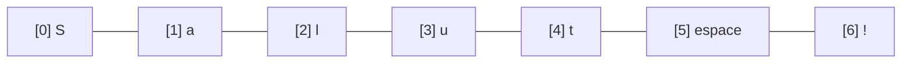
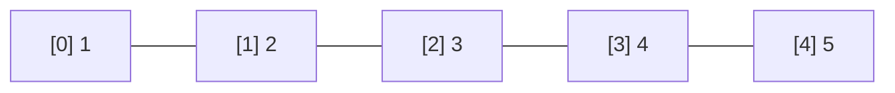
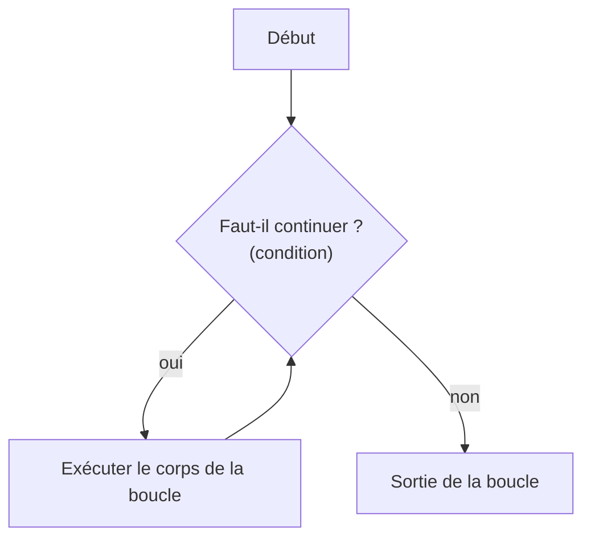
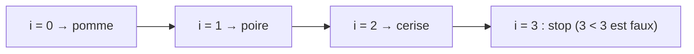
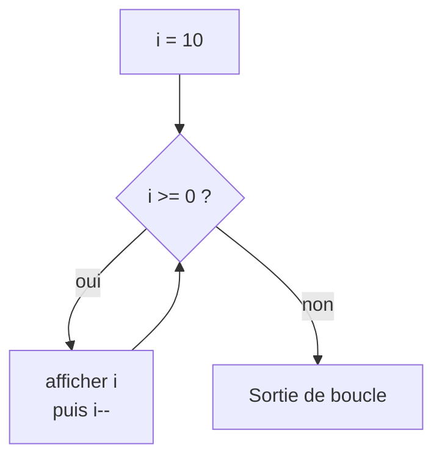
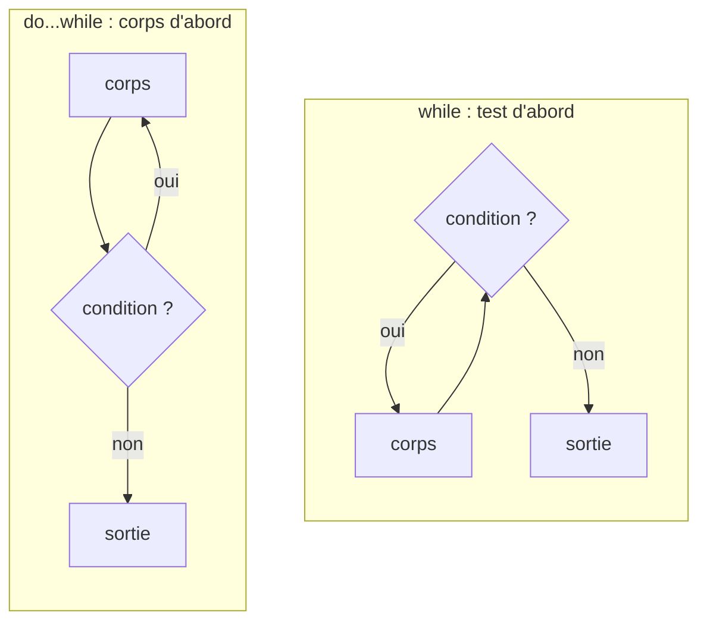
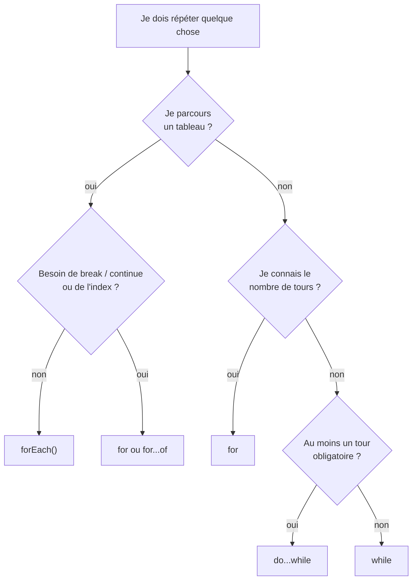

---
tags:
  - js
  - algo
  - boucles
  - tableaux
  - string
  - GRETA
cours: Algorithmique & JavaScript - partie 3 - Chaînes, tableaux et boucles (Thierry Bouedo)
---

# JavaScript : chaînes, tableaux et boucles

#js #algo #boucles #tableaux #string #debutant

## Résumé

Trois idées à retenir :

1. Un **texte** (chaîne) est une **suite de caractères numérotés**, que je peux lire un par un.
2. Un **tableau** est une **rangée de cases numérotées** qui contient plusieurs valeurs.
3. Une **boucle** est une **répétition automatique** : au lieu d'écrire 100 fois la même ligne, je la décris une fois et je dis à l'ordinateur combien de fois la refaire.

Les boucles servent surtout à **parcourir** un texte ou un tableau, case par case, et à faire quelque chose avec chaque élément.

Pour les notions de base (variables, fonctions, conditions), voir [[Fiche - Algo et JavaScript (bases)]] et [[Fiche - Les algorithmes (vulgarisation)]].

---

## 1. Les types déjà rencontrés : récapitulatif

Un **type primitif** est un type de valeur simple. J'en connais cinq :

| Type | Ce que c'est | Exemple |
|---|---|---|
| `string` | du texte | `"bonjour"` |
| `number` | un nombre (entier ou à virgule) | `42`, `3.14` |
| `boolean` | vrai ou faux | `true`, `false` |
| `undefined` | « pas défini » : la variable existe mais n'a **pas encore de valeur** | `let x;` |
| `null` | « rien / vide / ça n'existe pas » : une absence **volontaire** | `let y = null;` |

(Il existe un sixième type, `symbol`, que je n'étudie pas.)

**Analogie** :

- `undefined` = une boîte posée sur l'étagère avec une étiquette, **mais je n'ai encore rien mis dedans**.
- `null` = une boîte dans laquelle j'ai **volontairement** mis un papier « vide ».

```js
let myVariable;                // déclarée, sans valeur
console.log(myVariable);       // undefined

let result = null;             // je dis « il n'y a rien »
console.log(result);           // null
```

### Types primitifs et objets associés

Quand j'écris `"bonjour".length`, JavaScript me donne accès à des **propriétés** (sans parenthèses) et des **méthodes** (avec parenthèses) liées au type :

| Type | Objet associé | Exemples de propriétés | Exemples de méthodes |
|---|---|---|---|
| texte | `String` | `length` | `toUpperCase()`, `substring()` |
| nombre | `Number` | `MIN_VALUE`, `MAX_VALUE` | `parseInt()`, `parseFloat()`, `toFixed()` |
| booléen | `Boolean` | (aucune utile pour l'instant) | (aucune) |

**Repère** : parenthèses = méthode (une **action**), pas de parenthèses = propriété (une **information**).

---

## 2. Les chaînes de caractères (string)

### Idée simple

Une **chaîne** est un **collier de perles** : chaque perle est un caractère (lettre, chiffre, espace, ponctuation), et chaque perle a un **numéro de position** (l'**index**). **Le premier index est 0.**

Exemple avec `"Salut !"` :



**Remarque** : l'espace est un caractère comme un autre (il compte dans la longueur).

### Mode d'emploi : lire une chaîne

```js
let phrase = "Salut !";

phrase.length;              // 7 : nombre de caractères (espace compris)
phrase[0];                  // "S" : premier caractère (index 0)
phrase[4];                  // "t"
phrase[phrase.length - 1];  // "!" : dernier caractère
```

**Astuce** : le dernier index vaut toujours `length - 1`, parce qu'on compte à partir de 0.

### Quelques méthodes utiles

| Méthode | Ce qu'elle fait | Exemple | Résultat |
|---|---|---|---|
| `toUpperCase()` | Tout en majuscules | `"abc".toUpperCase()` | `"ABC"` |
| `toLowerCase()` | Tout en minuscules | `"ABC".toLowerCase()` | `"abc"` |
| `substring(début, fin)` | Extrait un morceau (de `début` **inclus** à `fin` **exclu**) | `"bonjour".substring(0, 3)` | `"bon"` |
| `indexOf("x")` | Position de la première occurrence (`-1` si absente) | `"bonjour".indexOf("j")` | `3` |
| `trim()` | Enlève les espaces au début et à la fin | `"  salut ".trim()` | `"salut"` |

### Concaténer : deux écritures

**Concaténer** = coller des textes bout à bout.

```js
let prenom = "Nico";

// Écriture 1 : avec +
console.log("Bonjour " + prenom + " !");

// Écriture 2 : avec des accents graves (backticks) et ${ }
console.log(`Bonjour ${prenom} !`);
```

La 2e écriture (**gabarit** ou *template literal*) est souvent plus lisible : je mets le **texte entre accents graves** `` ` `` et la **variable entre `${ }`**.

### Pièges courants

- Oublier que l'index commence à **0** : `"abc"[1]` vaut `"b"`, pas `"a"`.
- Écrire `phrase[phrase.length]` : cet index n'existe pas, le résultat est `undefined`.
- Oublier l'**espace** en concaténant : `"Bonjour" + prenom` donne `"BonjourNico"`.
- Les chaînes ne se modifient pas « sur place » : `phrase.toUpperCase()` **renvoie** une nouvelle chaîne, il faut la ranger : `phrase = phrase.toUpperCase();`.

---

## 3. Les tableaux (Array)

### Idée simple

Un **tableau** est une **rangée de casiers numérotés**, comme une planche-contact de photos : chaque vignette a son numéro, je peux aller chercher la n° 3 directement. Contrairement à une variable normale (une seule valeur), un tableau en range **plusieurs**.



### Créer un tableau : mode d'emploi

1. Écrire des **crochets** `[ ]`.
2. Mettre les valeurs **séparées par des virgules**.
3. Ranger le tout dans une variable.

```js
let myTableau1 = [1, 2, 3, 4, 5];                 // des nombres
let myTableau2 = [123, 'test', false, 2.5];       // types mélangés : autorisé
const MY_CONST_PI = 3.14159;
let myTableau3 = [123, 'test', [MY_CONST_PI, 'abc'], false, 2.5];   // un tableau DANS un tableau : autorisé
```

### Lire un élément : l'index

```js
let fruits = ['pomme', 'poire', 'cerise'];

console.log(fruits[0]);          // "pomme" : le PREMIER
console.log(fruits[2]);          // "cerise"
console.log(fruits.length);      // 3 : nombre d'éléments (propriété, pas de parenthèses)
```

**Rappel** : 3 éléments = index 0, 1, 2. **L'index 3 n'existe pas** (il donnerait `undefined`).

### Les méthodes principales des tableaux

Une **méthode** s'écrit avec un point après le nom du tableau : `tableau.methode()`.

| Méthode | Ce qu'elle fait | Exemple |
|---|---|---|
| `push(x)` | **Ajoute** à la fin | `fruits.push('kiwi')` donne `['pomme','poire','cerise','kiwi']` |
| `pop()` | **Retire** le dernier (et le renvoie) | `fruits.pop()` renvoie `'kiwi'` |
| `indexOf(x)` | Index de la **première** occurrence de `x` (`-1` si absent) | `fruits.indexOf('poire')` donne `1` |
| `lastIndexOf(x)` | Index de la **dernière** occurrence de `x` | utile si `x` est présent plusieurs fois |
| `at(i)` | Élément à l'index `i` ; accepte les index négatifs (`at(-1)` = le dernier) | `fruits.at(-1)` donne `'cerise'` |
| `forEach(fonction)` | Exécute une fonction **pour chaque** élément (voir section 5) | |

```js
let myTableau = [1, 2, 3, 4, 5];
myTableau.push('a', 6);          // on peut ajouter plusieurs valeurs
console.log(myTableau);          // [1, 2, 3, 4, 5, 'a', 6]
```

### Pièges courants

- **Casse** : c'est `forEach` (avec un E majuscule), pas `foreach`. JavaScript distingue majuscules et minuscules.
- Confondre `length` (propriété, **sans** parenthèses) et `push()` (méthode, **avec** parenthèses).
- Compter à partir de 1 au lieu de 0.
- `indexOf` renvoie **-1** si rien n'est trouvé : ce n'est pas un index valide.
- Taper le nom d'une variable qui n'existe pas (par exemple `console.log(tableau)` alors que mon tableau s'appelle `myTableau`).

---

## 4. Les boucles : répéter sans se fatiguer

### Pourquoi

Imaginer : afficher les 100 prénoms d'une liste. Sans boucle, il faut écrire 100 lignes. Avec une boucle, j'écris **1 ligne** et je dis « refais-la pour chaque prénom ».

**Analogies du quotidien** :

- Retoucher **chaque photo** d'un dossier : même geste, pour chaque photo.
- Lire **chaque candidature** d'une pile : même tri, pour chaque dossier.

### Le principe commun

Toute boucle contient :

1. des **instructions à répéter** (le **corps** ou **bloc de code**, entre accolades `{ }`) ;
2. une **règle** qui dit **quand continuer** et **quand s'arrêter** (la **condition**).



### Quel type de boucle ?

JavaScript en propose plusieurs : `for`, `for...of`, `for...in`, `while`, `do...while`, et la méthode `forEach`. Les sections suivantes les prennent une par une, de la plus courante à la plus rare.

---

## 5. La boucle `for` classique (pilotée par un index)

### Idée simple

C'est une boucle avec un **compteur**, comme un coureur qui compte ses tours de piste : « je commence au tour 0, je continue tant que je n'ai pas fait 5 tours, et à chaque tour j'ajoute 1 ».

### Structure : les 3 réglages entre parenthèses

```
for ( départ ; condition de maintien ; pas de progression ) {
    instructions répétées
}
```

| Réglage | Rôle | Dans l'exemple |
|---|---|---|
| **départ** (initialisation) | Je crée le compteur et je lui donne sa valeur de départ | `let i = 0` |
| **condition de maintien** | Tant qu'elle est **vraie**, la boucle continue | `i < 5` |
| **pas de progression** | Ce qui est fait **après chaque tour** | `i++` (ajouter 1) |

```js
for (let i = 0; i < 5; i++) {
  console.log("Notre variable d'index est égale à " + i);
  // Autre écriture avec des backticks :
  // console.log(`Notre variable d'index est égale à ${i}`);
}
// Affiche : 0, 1, 2, 3, 4  (5 tours, i ne vaut jamais 5 dans la boucle)
```

### Exécuter à la main (le déroulé)

| Tour | `i` au départ du tour | `i < 5` ? | Action | `i` après `i++` |
|---|---|---|---|---|
| 1 | 0 | oui | affiche 0 | 1 |
| 2 | 1 | oui | affiche 1 | 2 |
| 3 | 2 | oui | affiche 2 | 3 |
| 4 | 3 | oui | affiche 3 | 4 |
| 5 | 4 | oui | affiche 4 | 5 |
| fin | 5 | **non** | sortie de la boucle | |

### Parcourir un tableau ou un texte avec `for`

Le compteur `i` joue le rôle de l'**index** : je lis `tableau[i]` à chaque tour.

```js
let fruits = ['pomme', 'poire', 'cerise'];

for (let i = 0; i < fruits.length; i++) {   // i va de 0 à length - 1
  console.log(fruits[i]);
}
```



Même principe pour un texte :

```js
let mot = "photo";
for (let i = 0; i < mot.length; i++) {
  console.log(mot[i]);     // affiche p, h, o, t, o
}
```

### Une variable qui accumule (le « compteur » et le « total »)

Une boucle sert souvent à **construire un résultat petit à petit** : je crée une variable **avant** la boucle, et je la mets à jour **à chaque tour**.

```js
let prix = [10, 25, 5];
let total = 0;                     // 1. Je prépare la variable AVANT la boucle

for (let i = 0; i < prix.length; i++) {
  total += prix[i];                // 2. Je l'actualise à chaque tour
}

console.log(total);                // 3. Je l'utilise APRÈS la boucle : 40
```

### Pièges courants

- **`i <= tableau.length`** au lieu de `i < tableau.length` : le dernier tour lit une case qui n'existe pas (`undefined`). Erreur très fréquente, appelée **erreur d'un cran** (*off-by-one*).
- **Boucle infinie** : oublier le `i++` ou écrire une condition toujours vraie. La page se fige. Dans ce cas, fermer l'onglet et corriger.
- Déclarer l'accumulateur (`total`) **dans** la boucle : il est remis à zéro à chaque tour.
- Mettre un `;` juste après la parenthèse du `for` : `for (...);` casse la boucle.

---

## 6. La boucle `for...of` (pour chaque élément)

### Idée simple

Avec `for`, je gère moi-même le compteur. Avec `for...of`, je dis simplement « **pour chaque élément de ce tableau, fais ceci** », sans me préoccuper des index. C'est comme demander « pour chaque photo du dossier » au lieu de « photo n° 0, photo n° 1... ».

### Mode d'emploi

```js
let myTableau = ['a', 'bc', 123];

for (const item of myTableau) {
  console.log(item);          // affiche a, puis bc, puis 123
}
```

Lecture : « pour chaque `item` **de** `myTableau`, afficher `item` ».

- `item` est un nom que je choisis (`photo`, `fruit`, `lettre`...).
- À chaque tour, `item` prend la valeur de l'élément suivant.
- `const` est utilisé ici par convention, car je ne modifie pas `item` dans la boucle (`let` fonctionne aussi).

### Sur quoi marche `for...of` ?

Sur les objets **itérables**, c'est-à-dire ceux qui contiennent une **suite d'éléments à parcourir** : un tableau (`Array`), un texte (`String`), etc.

```js
for (const lettre of "photo") {
  console.log(lettre);        // p, h, o, t, o
}
```

### `for` ou `for...of` ?

| Besoin | Choix |
|---|---|
| J'ai besoin de **l'index** (position) | `for` classique |
| Je veux juste **chaque élément** | `for...of` (plus simple, moins d'erreurs) |

---

## 7. La boucle `for...in` (à venir)

`for...in` sert à parcourir les **propriétés d'un objet** JavaScript. Je ne l'utilise pas pour l'instant : le cours y reviendra quand les objets JavaScript seront étudiés.

---

## 8. La boucle `while` (tant que)

### Idée simple

« **Tant que** le café n'est pas prêt, j'attends. » Je ne sais pas à l'avance combien de tours il faudra : je continue **tant que la condition est vraie**. La condition est vérifiée **avant** chaque tour.

```js
let i = 10;
while (i >= 0) {          // condition vérifiée AVANT chaque tour
  console.log(i);
  i--;                    // on diminue i : sinon boucle infinie
}
console.log("Sortie de boucle");
// Affiche 10, 9, 8, ..., 2, 1, 0
```



### Les 3 éléments d'un `while` bien écrit

1. **Initialiser** la variable **avant** la boucle (`let i = 10`).
2. Une **condition** claire (`i >= 0`).
3. **Faire évoluer** la variable **dans** la boucle (`i--`), pour que la condition finisse par devenir fausse.

### Piège

Oublier de modifier la variable dans la boucle : la condition reste toujours vraie et c'est une **boucle infinie**.

---

## 9. La boucle `do...while` (faire, puis tant que)

### Idée simple

Même principe que `while`, mais la condition est vérifiée **après** le tour. La boucle s'exécute donc **au moins une fois**. C'est comme **goûter** un plat **avant** de décider s'il faut en reprendre.

```js
let i = 10;
do {
  console.log(i);
  i--;
}
while (i >= 0);          // condition vérifiée APRÈS le tour (point-virgule final)
```

### La différence en une image

Avec `let i = -10;` :

| Boucle | Résultat |
|---|---|
| `while (i >= 0) {...}` | **0 tour** : la condition est fausse dès le départ |
| `do {...} while (i >= 0);` | **1 tour** : le corps est exécuté une fois avant le test |



---

## 10. `break` et `continue` : sortir ou sauter

Deux mots-clés pour **contrôler** une boucle de l'intérieur.

| Mot-clé | Effet | Analogie |
|---|---|---|
| `break` | **Arrête complètement** la boucle (fin anticipée) | Je trouve le dossier que je cherchais : j'arrête de feuilleter la pile |
| `continue` | **Saute le tour en cours** et passe au suivant | Je tombe sur une candidature incomplète : je l'écarte et je passe à la suivante |

```js
// break : on s'arrête quand i vaut 3
for (let i = 0; i < 5; i++) {
  if (i === 3) {
    break;
  }
  console.log(i);
}
// Affiche : 0, 1, 2
```

```js
// continue : on saute seulement le tour où i vaut 3
for (let i = 0; i < 5; i++) {
  if (i === 3) {
    continue;
  }
  console.log(i);
}
// Affiche : 0, 1, 2, 4
```

---

## 11. `forEach` : une méthode de tableau

### Idée simple

`forEach` n'est pas une boucle « mot-clé » comme `for`, c'est une **méthode des tableaux**. Je lui donne une **fonction**, et elle l'applique à **chaque élément** du tableau, un par un.

**Analogie** : je donne une **consigne écrite** (la fonction) à un assistant (`forEach`), et il l'exécute pour chaque photo du dossier.

```js
const myList = ['a', 'b', 'c'];

myList.forEach(function (item) {
  console.log(item);          // affiche a, puis b, puis c
});
```

Lecture :

- `forEach` est appelée **sur le tableau** `myList`.
- Elle prend **en paramètre une fonction** (cette fonction passée en paramètre s'appelle une **fonction de rappel**, ou *callback*).
- À chaque tour, `item` prend la valeur de l'élément en cours.

### Préambule : trois façons d'écrire une fonction

Pour utiliser `forEach`, il faut connaître les différentes écritures d'une fonction :

```js
// 1. Déclaration classique (celle que je connais déjà)
function maFonction(param1) {
  // code
}

// 2. Fonction rangée dans une variable (c'est en fait ce que fait la déclaration 1)
const maFonction = function (param1) {
  // code
};

// 3. Fonction fléchée (depuis 2015) : la flèche => remplace le mot function
const maFonction = (param1) => {
  // code
};
```

**Raccourci** : si le corps de la fonction ne contient qu'**une seule instruction**, les accolades peuvent être omises.

### Les 4 façons d'utiliser `forEach`

```js
// 1) Fonction nommée, écriture classique
myArray.forEach(function maFonction(param1) {
  // code
});

// 2) Fonction anonyme (sans nom), écriture classique
myArray.forEach(function (param1) {
  // code
});

// 3) Fonction fléchée (sans nom)
myArray.forEach((param1) => {
  // code
});

// 4) Fonction déclarée AILLEURS, puis passée par son nom (sans parenthèses !)
myArray.forEach(maFonction);
```

Un **piège** classique dans le cas 4 : écrire `maFonction()` avec des parenthèses l'exécuterait **tout de suite** ; il faut écrire `maFonction` **seule**.

### Attention

`forEach` travaille **directement sur le tableau**, pas sur une copie. Si je **modifie le tableau pendant le parcours** (ajout, suppression), le résultat peut devenir imprévisible. Pendant une boucle, je ne modifie pas le tableau que je parcours.

### Limites de `forEach`

- Elle ne marche **que sur les tableaux** (pas sur un texte directement).
- Elle ne supporte pas `break` ni `continue` (pour sortir tôt, utiliser `for` ou `for...of`).

---

## 12. Quelle boucle choisir ?

Ordre de priorité conseillé :

1. **`forEach()`**, mais **seulement** si je parcours un **tableau**.
2. **`for` / `for...of`** (et `for...in` pour les objets, plus tard).
3. **`while` / `do...while`** quand je ne sais pas à l'avance combien de tours il faudra.



---

## 13. Méthode pour résoudre un exercice d'algorithmique

Conseils du cours, à appliquer à chaque exercice :

1. **Découper** le problème en petites sous-parties, **sans chercher le résultat tout de suite**. Au besoin, faire valider le découpage avant de coder.
2. **Avancer pas à pas** avec la documentation de référence (**MDN Web Docs**, éventuellement W3Schools). Inutile de chercher du « tout fait » sur le web : c'est une perte de temps.
3. **Documenter** son code par des commentaires : en apprentissage, mieux vaut trop de commentaires que pas assez. Écrire ce que j'attends de chaque bloc.
4. **Utiliser les outils** : la coloration syntaxique et l'aide de VSCode pour écrire, et pour tester la console ou, mieux, le **débogueur**.

### Mode d'emploi : le débogueur (pas à pas)

1. Ouvrir la page dans le navigateur, puis `F12`.
2. Aller dans l'onglet **Débogueur** (Firefox) ou **Sources** (Chrome).
3. Ouvrir mon fichier JS et cliquer sur le **numéro d'une ligne** pour poser un **point d'arrêt** : le programme s'arrête à cet endroit.
4. Déclencher mon code (clic sur le bouton).
5. Avancer **ligne par ligne** (touche `F10`) en regardant la **valeur des variables** à chaque étape.

C'est la version « automatique » du tableau d'exécution à la main de la section 5.

### Méthode type pour « traiter chaque élément »

```
1. Que dois-je obtenir à la fin ? (une valeur, un texte, un message)
2. Que dois-je savoir ou garder en mémoire pendant le parcours ?
   → ce sont mes variables, créées AVANT la boucle
3. Que dois-je faire avec chaque élément ?
   → c'est le corps de la boucle
4. Que faire de spécial pour le premier ou le dernier élément ?
   → un cas particulier à prévoir
5. Que faire une fois la boucle terminée ?
   → afficher le résultat, APRÈS la boucle
```

### Indices donnés par le cours pour les exercices

- **Exercice « Les mots »** (compter les mots d'une phrase tapée dans un champ) : parcourir **tous les caractères un par un**, et à chaque tour **comparer le caractère courant avec le caractère précédent**. Une transition « espace puis autre chose » marque le **début d'un nouveau mot**. Pour le premier caractère, il n'y a pas de précédent : faire comme si c'était un espace. Prévoir aussi les espaces **en double** et ceux **au début et à la fin**. Faire un petit schéma sur papier avant de coder.
- **Exercice « La moyenne »** : proposer **2 solutions**, l'une avec un `for` (index ou `for...of`), l'autre avec `forEach()`.
- **Exercice de synthèse** (moyenne affichée dans la page HTML) : réutiliser les extraits de l'exercice précédent.

Les corrections sont dans le dépôt GitHub du cours (dossier `corrections`).

---

## Récapitulatif des pièges de débutant

- Index qui commence à **0** ; dernier index = `length - 1`.
- `<=` au lieu de `<` dans une boucle `for` sur un tableau (erreur d'un cran).
- **Boucle infinie** : variable jamais modifiée, ou condition toujours vraie.
- Accumulateur déclaré **dans** la boucle (remis à zéro à chaque tour).
- `foreach` au lieu de `forEach` (la casse compte).
- `maFonction()` au lieu de `maFonction` quand je passe une fonction à `forEach`.
- Modifier un tableau pendant qu'on le parcourt.
- Oublier que `undefined` n'est pas `null`.
- Confondre propriété (`length`) et méthode (`push()`).

---


## Liens

[[Fiche - Algo et JavaScript (bases)]] · [[Fiche - Les algorithmes (vulgarisation)]] · [[JS - DOM et événements]] · [[JS - objets]] · [[<>Git et GitHub_Fiche]]
