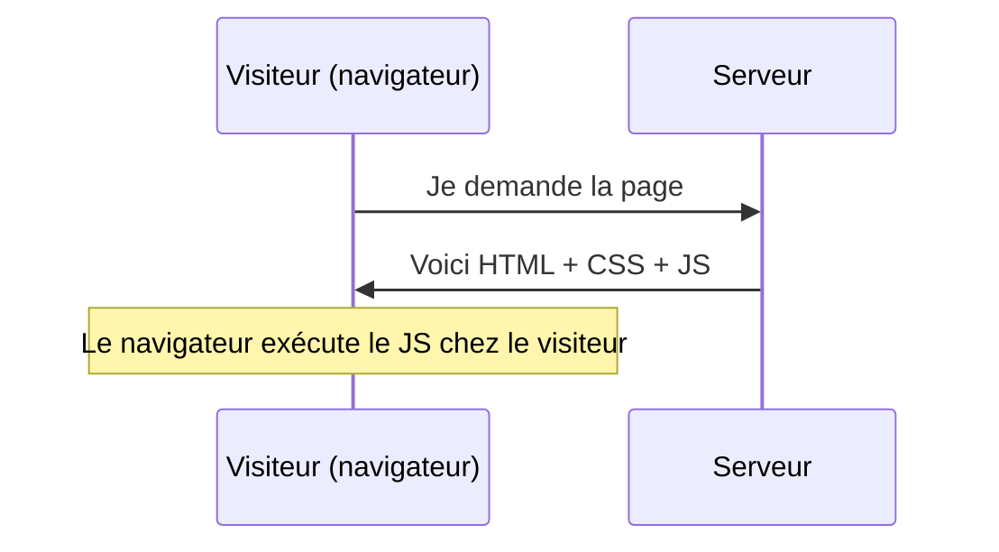
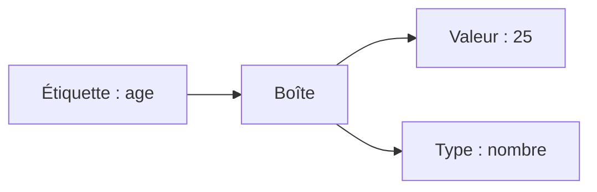
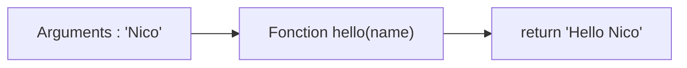
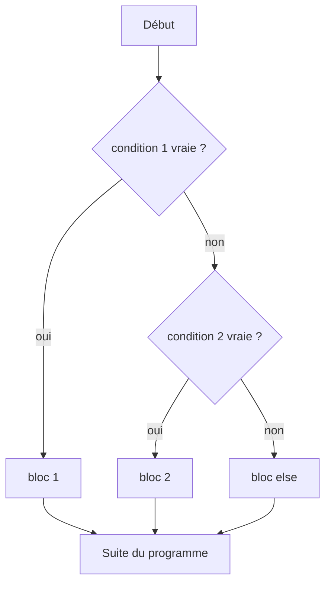
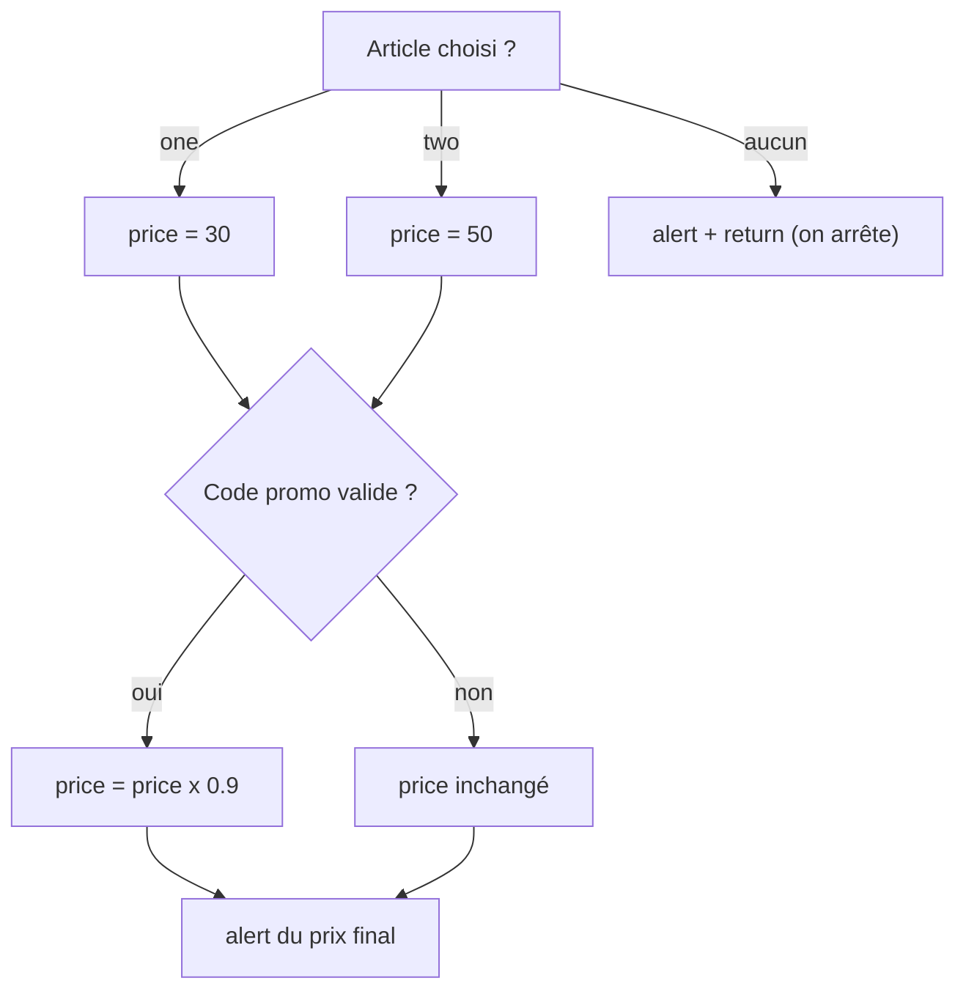
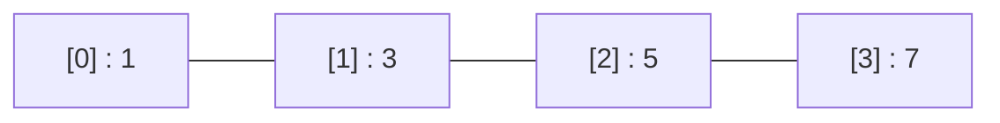
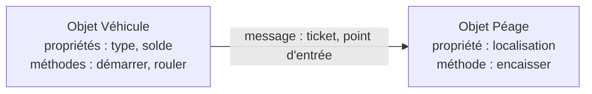

---
tags:
  - js
  - algo
  - bases
cours: Algorithmique & JavaScript - parties 1 et 2 (Thierry Bouedo)
dates: 06.11.2026 / 10.11.2026
---

# Algorithmique et JavaScript : les bases

#js #algo #variables #fonctions #conditions #html

## Résumé

JavaScript (JS) est le langage qui rend une page web **vivante** : il réagit à un clic, lit ce qu'écrit le visiteur, calcule, affiche un message. Un **algorithme** est simplement une **recette** : une suite d'instructions précises pour obtenir un résultat. Pour écrire une recette que l'ordinateur comprend, j'utilise des **variables** (les ingrédients), des **fonctions** (les étapes réutilisables) et des **conditions** (les choix : « si... sinon... »).

---

## 1. Comprendre ce qu'est JavaScript

### Idée simple

HTML = la structure (le squelette), CSS = l'apparence (les vêtements), **JS = le comportement** (les muscles).

### Fiche d'identité

| Caractéristique                 | Ce que ça veut dire                                                                                                             |
| ------------------------------- | ------------------------------------------------------------------------------------------------------------------------------- |
| Créé en 1995                    | Par les créateurs du navigateur Netscape                                                                                        |
| Langage « standard »            | Chrome, Firefox, Safari le comprennent tous, de la même façon. Les standards sont publiés par **ECMA International**            |
| **Dynamique**                   | Il modifie le HTML / CSS selon des **événements** (un clic) ou des **variables** (la date)                                      |
| **Interprété**                  | Pas de traduction préalable en code machine : le navigateur contient un **interpréteur** qui lit et exécute le code directement |
| **Côté client** (*client side*) | Le serveur envoie le fichier JS, mais il s'exécute **dans le navigateur** du visiteur                                           |
| Orienté objet                   | Vu plus loin (section 8)                                                                                                        |



---

## 2. Mettre du JS dans une page : mode d'emploi

1. Ouvrir (ou créer) un fichier `.html` dans VSCode.
2. Ajouter, **en fin de page** (avant `</body>`), une balise `<script>` :

```html
<script type="text/javascript">
    // mon code JS ici
</script>
```

3. Ouvrir la page dans le navigateur.
4. Ouvrir la **console** du navigateur : `F12` puis onglet **Console**.

### Règles d'exécution à retenir

- **Une instruction par ligne**, terminée par un `;`.
- Une instruction écrite **directement** dans `<script>` (hors fonction) s'exécute **au chargement de la page**, dans l'ordre.
- Une **fonction déclarée** ne s'exécute **que si elle est appelée**.

```html
<script>
    function afficherMessage() {
        alert("La fonction est exécutée !");
    }
    // Sans la ligne suivante : rien ne se passe
    afficherMessage();
</script>
```

### Afficher un résultat : trois outils

| Outil                                 | Usage                                                                          | Exemple               |
| ------------------------------------- | ------------------------------------------------------------------------------ | --------------------- |
| `console.log(x)`                      | Voir la valeur de `x` dans la console (pour **tester**, invisible du visiteur) | `console.log(age);`   |
| `alert("...")`                        | Fenêtre pop-up avec un message (message, ou résultat d'une fonction)           | `alert("Bienvenue");` |
| `document.getElementById("id").value` | **Lire** ce qu'un visiteur a saisi dans un champ HTML                          | voir section 9        |

---

## 3. Les commentaires

### Pourquoi

Un commentaire est ignoré par l'ordinateur. Il sert à **expliquer le pourquoi** à la personne qui relira le code (moi dans 3 mois, ou un collègue).

### Syntaxe

```js
// commentaire sur UNE ligne

/*
 * commentaire sur
 * PLUSIEURS lignes
 */
```

- Raccourci VSCode pour commenter / décommenter la ou les lignes sélectionnées : **Ctrl + /** (sur clavier AZERTY, j'ai noté `Ctrl + Maj + /` : à tester dans mon VSCode).

### Bon commentaire / mauvais commentaire

```js
// MAUVAIS : répète le code, n'apprend rien
/* Afficher Hello world dans une alert */
function afficherHelloWorld() {
  alert('Hello world'); // On affiche Hello world grâce à la fonction alert
}

// BON : donne le contexte et l'utilité, ce qu'on ne voit pas dans le code
/*
 * This function checks that the JavaScript file is correctly linked.
 *
 * It will be removed in the next release.
 */
function afficherHelloWorld() {
  alert('Hello world');
}
```

**Bonne pratique** : écrire les commentaires **en anglais**.

### Pièges

- Un commentaire qui paraphrase le code (inutile).
- Utiliser `//` pour un long texte : passer à `/* ... */`.

---

## 4. Variables, types et constantes

### Idée simple

Une **variable** = une **boîte étiquetée**. L'étiquette est le **nom**, le contenu est la **valeur**. Chaque boîte accepte un certain **type** de contenu.



### Déclarer et utiliser une variable : mode d'emploi

1. Choisir un mot-clé de déclaration : `let` (ou `const` si la valeur ne bougera jamais).
2. Donner un nom clair, en anglais, en `camelCase` : `firstName`, `favoriteNumber`.
3. **Affecter** une valeur avec `=`.
4. Lire la valeur en écrivant simplement le **nom**.

```js
let age = 25;            // déclaration + affectation
age = 26;                // je change la valeur (let le permet)
console.log(age);        // affiche 26
```

### `let`, `var`, `const` : lequel choisir ?

| Mot-clé | Réaffectable ? | Usage aujourd'hui                                                                                                                         |
| ------- | -------------- | ----------------------------------------------------------------------------------------------------------------------------------------- |
| `let`   | **Oui**        | Variable normale : **à privilégier**                                                                                                      |
| `var`   | Oui            | Ancienne façon. Vu dans la partie 1 du cours et Silent Teacher. Comportement de portée moins prévisible : je l'évite dans mon propre code |
| `const` | **Non**        | Valeur fixe : doit recevoir sa valeur **dès la déclaration** et ne change plus                                                            |

### Constante : convention de nommage

Une **constante** est une variable qui ne varie pas. Par convention, son nom s'écrit en **MACRO_CASE** (MAJUSCULES avec `_`).

```js
const MAJORITY = 18;          // l'âge de la majorité ne change pas
const MELTING_POINT = 0;      // température de fusion de la glace
const VALID_PROMOTION_CODE = "10POUR100";

MAJORITY = 21;                // ERREUR : on ne peut pas réaffecter une constante
```

### Les types primitifs (les types de base)

Un **type primitif** est un type de valeur simple, de base (pas composé d'autres valeurs).

| Type      | Définition                                                            | Exemple      |
| --------- | --------------------------------------------------------------------- | ------------ |
| `string`  | **Chaîne de caractères** = du texte, entre guillemets `" "` ou `' '`  | `"bonjour"`  |
| `number`  | **Nombre**, entier ou décimal                                         | `42`, `3.14` |
| `boolean` | **Booléen** : seulement deux valeurs, `true` (vrai) ou `false` (faux) | `true`       |

Précisions de vocabulaire (mes termes à définir) :

- **Nombre entier** (*integer*) : un nombre sans virgule, `-3`, `0`, `42`.
- **Nombre flottant** (*float*) : un nombre **à virgule**, `3.14`. Attention : en JS on écrit un **point** (`3.14`), pas une virgule.
- En JS, il n'y a qu'**un seul type `number`** pour les deux. Quand je dois convertir, je choisis entre `parseInt` (entier) et `parseFloat` (décimal).

Pour vérifier le type d'une valeur : `typeof "bonjour"` donne `"string"`.

### Opérateurs de base

| Opérateur   | Rôle                                                               | Exemple                                      |
| ----------- | ------------------------------------------------------------------ | -------------------------------------------- |
| `=`         | **Affecter** (ranger une valeur dans la boîte)                     | `a = 5`                                      |
| `+`         | Additionner **des nombres** ou **concaténer** (coller) des chaînes | `2 + 3` donne `5` ; `"a" + "b"` donne `"ab"` |
| `-` `*` `/` | Soustraction, multiplication, division **décimale**                | `5 / 2` donne `2.5`                          |
| `%`         | **Modulo** : reste de la division entière                          | `7 % 2` donne `1`                            |

```js
let str = "bonjour";
str += "!";             // str vaut maintenant "bonjour!"
```

### Raccourcis d'écriture (incrémenter)

**Incrémenter** = augmenter de 1. **Décrémenter** = diminuer de 1.

```js
a++;          // équivaut à a = a + 1
a--;          // équivaut à a = a - 1
a += 20;      // équivaut à a = a + 20
```

### Pièges courants

- Confondre `=` (affecter) avec `==` / `===` (comparer).
- `+` entre un nombre écrit comme **texte** et un nombre = **concaténation**, pas addition (voir section 5).
- Écrire une virgule au lieu d'un point pour un décimal.

---

## 5. Convertir un texte en nombre

### Pourquoi

Ce qu'un visiteur tape dans un champ `<input>` est lu par `.value` **toujours sous forme de texte** (`string`), même si c'est « 3 ».

```js
let number = "3";
number += 11;
console.log(number);   // "311"  (concaténation, pas 14 !)
```

### Mode d'emploi : `parseInt()`

1. Lire la valeur du champ.
2. La **convertir** en nombre entier avec `parseInt()`.
3. Faire le calcul.

```js
function incrementNumber() {
  // Lecture du champ HTML (c'est du texte)
  let number = document.getElementById("number").value;

  // Conversion + calcul en une ligne (solution recommandée)
  alert(parseInt(number) + 1);
}
```

```js
// Variante : augmenter de 11 au lieu de 1
function incrementNumber() {
  let number = parseInt(document.getElementById("number").value);
  number += 11;        // OK car number est maintenant un nombre
  alert(number);       // "3" donne 14
}
```

### Les outils de conversion

| Fonction | Résultat |
|---|---|
| `parseInt("3")` | `3` (entier) |
| `parseFloat("3.5")` | `3.5` (décimal) |
| `Number("3")` | `3` (autre solution possible) |

### Pièges courants

- Oublier de convertir : le `+` colle au lieu d'additionner. Attention : `a += 11` **ne convertit pas** le type de `a` (contrairement à `++a`), donc je convertis d'abord avec `parseInt`.
- `parseInt("abc")` donne `NaN` (*Not a Number* : pas un nombre).

Documentation : [parseInt (MDN)](https://developer.mozilla.org/fr/docs/Web/JavaScript/Reference/Global_Objects/parseInt)

---

## 6. Les fonctions

### Idée simple

Une **fonction** = une **mini-recette réutilisable** à laquelle je donne un nom. Je l'écris une fois, je l'appelle autant de fois que je veux.

### Vocabulaire

| Mot | Définition |
|---|---|
| **Paramètre** | Variable interne de la fonction, écrite entre parenthèses **à la déclaration** (l'emplacement vide) |
| **Argument** | La valeur concrète que je donne **à l'appel** (ce que je mets dans l'emplacement) |
| `return` | Renvoie un résultat à l'endroit où la fonction a été appelée, et **arrête** la fonction |
| **Appeler** | Écrire le nom de la fonction suivi de parenthèses |

### Déclarer une fonction : mode d'emploi

1. Écrire le mot-clé `function`.
2. Écrire le nom de la fonction (verbe + `camelCase` : `verifyAge`).
3. Écrire les paramètres entre parenthèses (vides si aucun).
4. Écrire les instructions entre accolades `{ ... }`.
5. Si besoin, terminer par `return`.

```js
// Déclaration : name est le PARAMÈTRE
function hello(name) {
  return "Hello " + name;
}

// Appel : "Nico" est l'ARGUMENT
hello("Nico");                    // renvoie "Hello Nico"

// Stocker le résultat dans une variable
let message = hello("Nico");      // message vaut "Hello Nico"

// Fonction sans paramètre : parenthèses vides OBLIGATOIRES à l'appel
function helloWorld() {
  return "Hello World !";
}
helloWorld();
```



### Déclencher une fonction sur un clic

Une fonction JS est surtout appelée quand un **événement** se produit (clic, saisie...).

```html
<input type="text" id="number" placeholder="Mon nombre chance"/>
<button type="button" class="btn btn-primary" onclick="incrementNumber()">
  Afficher le nombre suivant
</button>
```

`onclick="incrementNumber()"` signifie : au clic sur ce bouton, appelle la fonction `incrementNumber`.

### Écriture fonctionnelle : découper en petites fonctions

Principe : plutôt qu'une grosse fonction qui fait tout, j'écris **plusieurs petites fonctions** qui font chacune **une seule chose** et **retournent** un résultat (souvent un booléen), puis je les **combine** (voir l'exercice de la soupe, section 10).

- L'**ordre de déclaration** des fonctions n'a pas d'importance (je peux appeler `isSalty()` avant sa déclaration dans le fichier).

### Pièges courants

- Déclarer la fonction mais **oublier de l'appeler** : rien ne se passe.
- Oublier les parenthèses à l'appel : `helloWorld` (sans `()`) n'exécute rien.
- Écrire du code **après** un `return` : il ne sera jamais exécuté.

---

## 7. Les booléens et la logique

### Idée simple

Un **booléen** répond à une question par **oui ou non**. Les conditions (« si... ») se basent toutes dessus. Inventé par George **Boole** (d'où « algèbre de Boole »).

- Deux valeurs : `true` / `false` (notées aussi **1** / **0**).
- Exemple : `a = 1` pour « nous sommes lundi » ; `a = 0` si nous sommes jeudi.

### Les opérateurs de comparaison (donnent un booléen)

| Opérateur | Signification |
|---|---|
| `<` `<=` `>` `>=` | Inférieur, inférieur ou égal, supérieur, supérieur ou égal |
| `==` | Égalité **faible** (compare les valeurs **après conversion de type**) |
| `===` | Égalité **stricte** (compare la valeur **et** le type) |
| `!=` | Différence faible |
| `!==` | Différence stricte |

```js
"2" === 2;   // false  (texte et nombre : types différents)
"2" == 2;    // true   (valeurs égales après conversion)
"2" !== 2;   // true
"2" != 2;    // false
```

**Bonne pratique** : utiliser `===` et `!==` par défaut.

### Les opérateurs logiques

| JS | Nom | Sens |
|---|---|---|
| `&&` | **ET** (AND) | Vrai si **toutes** les conditions sont vraies |
| `\|\|` | **OU** (OR) | Vrai si **au moins une** condition est vraie |
| `!` | **NON** (négation) | Inverse la valeur |

**Tables de vérité** :

| exp1 | exp2 | `exp1 && exp2` | `exp1 \|\| exp2` |
|---|---|---|---|
| false | false | false | false |
| false | true | false | true |
| true | false | false | true |
| true | true | true | true |

| A | `!A` |
|---|---|
| false | true |
| true | false |

**Priorité** : sans parenthèses, le **ET passe avant le OU**. Je mets des parenthèses en cas de doute.

### Pièges courants

- **Ne jamais confondre `=` (affecter) et `===` (comparer)** : `if (a = 5)` ne compare pas, il affecte !
- Comparer un texte lu dans un champ avec un nombre en `===` : toujours faux si je n'ai pas converti avant.

---

## 8. Les conditions : if / else if / else

### Idée simple

Un carrefour : selon la situation, je prends **une seule** route.



### Les 3 formes

```js
// Forme 1 : si
if (condition) {
  // bloc de code
}

// Forme 2 : si / sinon
if (condition) {
  // bloc de code
} else {
  // bloc de code
}

// Forme 3 : si / sinon si / sinon
if (condition1) {
  // bloc 1
} else if (condition2) {   // peut être répété plusieurs fois
  // bloc 2
} else {
  // bloc par défaut
}
```

### Règles

1. Toujours commencer par `if`, suivi d'une **condition entre parenthèses**, puis d'un bloc entre accolades `{ }`.
2. `else` est **facultatif**.
3. `else if` peut être répété autant de fois que nécessaire, `else` vient **en dernier**.
4. **Un seul et unique bloc** est exécuté (le premier dont la condition est vraie).
5. Si les choix deviennent nombreux : utiliser `switch`.

Documentation : [if...else (MDN)](https://developer.mozilla.org/fr/docs/Web/JavaScript/Reference/Statements/if...else)

### Exemple : vérifier la majorité

```js
const MAJORITY = 18;

function verifyAge() {
  let age = document.getElementById("age").value;

  if (age >= MAJORITY) {
    alert("Bienvenue sur le site");
  } else {
    alert("Vous devez être majeur pour accéder au site !");
  }
}
```

### Exemple : pair ou impair avec le modulo

**Modulo `%`** = le **reste** de la division entière. `7 % 2` : 7 = (3 × 2) + **1**, donc le reste est 1.

```js
function evenOrOdd() {
  let number = document.getElementById("number").value;

  // Un nombre pair a un reste de 0 quand on le divise par 2
  if (number % 2 === 0) {
    alert(number + " est pair");
  } else {
    alert(number + " est impair");
  }
}
```

**Piège** : tester `number % 2 === 1` pour « impair » fonctionne pour les nombres positifs, mais pour un nombre **négatif** (`-3 % 2`) le résultat est `-1`. Tester `=== 0` pour « pair » et laisser le `else` pour « impair » évite ce problème.

### Exemple : if / else if / else

```js
function primaryColors() {
  let secondaryColor = document.getElementById("colors").value;

  if (secondaryColor === "green") {
    alert("Vert est composé de bleu et de jaune");
  } else if (secondaryColor === "purple") {
    alert("Violet est composé de rouge et de bleu");
  } else if (secondaryColor === "orange") {
    alert("Orange est composé de rouge et de jaune");
  } else {
    alert("Cette couleur n'est pas valide");
  }
}
```

Sur une liste déroulante `<select>`, `.value` donne directement la valeur choisie.

---

## 9. `switch` : choix multiples (plus lisible, principe DRY)

**DRY** = *Don't Repeat Yourself* : ne pas répéter les mêmes choses. Ici, je n'écris plus `secondaryColor ===` à chaque fois.

### Mode d'emploi

1. `switch (variable)` : la variable à examiner.
2. Un `case valeur:` par possibilité.
3. Terminer chaque `case` par **`break;`** (sinon l'exécution « tombe » dans le cas suivant).
4. `default:` = le cas où aucun `case` ne correspond (équivalent du `else`).

```js
function primaryColors() {
  let secondaryColor = document.getElementById("colors").value;

  switch (secondaryColor) {
    case 'green':
      alert("Le vert est composé de bleu et de jaune");
      break;
    case 'purple':
      alert("Le violet est composé de bleu et de rouge");
      break;
    case 'orange':
      alert("L'orange est composé de rouge et de jaune");
      break;
    default:
      console.log(secondaryColor + " n'est pas une couleur reconnue");
  }
}
```

### Piège

- **Oublier `break`** : les cas suivants s'exécutent aussi.

### Variante : `switch (true)` (bonus)

Permet de mettre des **conditions** dans les `case` au lieu de simples valeurs :

```js
function doYouLikeIt() {
  switch (true) {
    case isPoisoned():
      alert("Game over !");
      break;
    case isSalty() && !isSweet():
      alert("Hum... la bonne sou-soupe salée !");
      break;
    case isSweet() && !isSalty():
      alert("Hum... la bonne sou-soupe sucrée !");
      break;
    case isSalty() && isSweet():
      alert("Beurk ! C'est pas bon...");
      break;
    default:
      alert("Peux-tu cocher au moins une case, s'il te plaît ?");
  }
}
```

À étudier : le `switch` classique (MDN), puis la variante `switch (true)` (article Medium indiqué par le prof).

---

## 10. Combiner : validation, panier et soupe

### Mot de passe : deux conditions avec `&&`

```js
function verifyPassword() {
  let password = document.getElementById("password").value;
  let confirmation = document.getElementById("confirmation").value;

  // Les deux champs identiques ET au moins 8 caractères
  if (password === confirmation && password.length >= 8) {
    alert("Bienvenue sur le site");
  } else {
    alert("Votre mot de passe doit avoir au minimum 8 caractères");
  }
}
```

`password.length` : la **propriété** « longueur » du texte.

### Panier : refactoriser avec un arbre de décision

**Refactoriser** = réécrire un code qui marche pour le rendre plus propre, **sans changer son résultat**.

Méthode :

1. Écrire une première version qui marche (plusieurs `else if` avec des conditions qui se répètent).
2. **Repérer les répétitions** (le code promo et l'article reviennent plusieurs fois).
3. Dessiner l'**arbre de décision** : d'abord l'article (prix de base), ensuite la promo (réduction).
4. Utiliser `return` pour **arrêter** la fonction si aucun article n'est choisi.



```js
const VALID_PROMOTION_CODE = "10POUR100";

function cartValue() {
  // get the selected item
  let articles = document.getElementById("articles");
  let selectedArticle = articles.options[articles.selectedIndex].value;

  // compute the original price (without discount)
  let price;
  if (selectedArticle === "one") price = 30;
  else if (selectedArticle === "two") price = 50;
  else {
    alert("Vous devez choisir un article");
    return;            // arrête la fonction ici
  }

  // get and apply the discount code (if any)
  let promotion = document.getElementById("promotion").value;
  if (promotion === VALID_PROMOTION_CODE) price *= 0.9;   // -10 %

  // display the final message
  alert("La valeur de votre panier est : " + price + " euros");
}
```

Avantage par rapport à la première version : le cas « aucun article sélectionné » est traité, et chaque règle (prix, promo) n'est écrite qu'une fois.

### Soupe : trois petites fonctions + une fonction qui les combine

Cases à cocher : `.checked` donne `true` si la case est cochée.

```js
function isSalty() {
  let carrots = document.getElementById("carrots").checked;
  let potatoes = document.getElementById("potatoes").checked;
  let tomatoes = document.getElementById("tomatoes").checked;
  return carrots || potatoes || tomatoes;     // au moins un ingrédient salé
}

function isSweet() {
  let blackChocolate = document.getElementById("black-chocolate").checked;
  let whiteChocolate = document.getElementById("white-chocolate").checked;
  return blackChocolate || whiteChocolate;
}

function isPoisoned() {
  let vitriol = document.getElementById("vitriol").checked;
  let cyanide = document.getElementById("cyanide").checked;
  return vitriol || cyanide;
}

function doYouLikeIt() {
  if (isPoisoned()) {                 // le poison passe en premier
    alert("Game over...");
  } else if (isSalty() && isSweet()) {
    alert("Beurk... c'est pas bon !");
  } else if (isSalty() || isSweet()) {
    if (isSalty()) {
      alert("Hum la bonne sou-soupe salée !");
    } else {
      alert("Hum la bonne sou-soupe sucrée !");
    }
  } else {
    alert("J'ai faim !");
  }
}
```

**Astuce** : l'**ordre des conditions compte** : je mets d'abord le cas le plus grave (poison), ensuite les cas particuliers, et le cas général en dernier.

---

## 11. La console et les calculs

```js
let favoriteNumber = 73;
favoriteNumber = favoriteNumber * favoriteNumber;   // 73 x 73
favoriteNumber = favoriteNumber * 73;               // x 73 encore
favoriteNumber = favoriteNumber / 1000;
console.log(Math.round(favoriteNumber));            // 389  (arrondi)

// Version plus élégante avec la puissance
let favoriteNumber2 = Math.pow(73, 3) / 1000;
console.log(Math.round(favoriteNumber2));
```

- `Math.round(x)` : arrondit à l'entier le plus proche.
- `Math.pow(a, b)` : `a` puissance `b`.
- `x.toFixed(2)` : arrondit à 2 décimales (utile pour les prix).

### Convertisseur de devises : exemple complet

```html
<script type="text/javascript">
  const EURO_TO_USD = 1.1015;     // 1 EUR = 1.1015 USD

  function convert() {
    let value = document.getElementById("value").value;
    let currency = document.getElementById("currencies").value;

    if (currency === "eur") {
      alert(value + " Euros -> " + Number.parseFloat(value * EURO_TO_USD).toFixed(2) + " Dollars");
    } else {
      alert(value + " Dollars -> " + Number.parseFloat(value / EURO_TO_USD).toFixed(2) + " Euros");
    }
  }
</script>

<!-- Ne pas oublier l'événement qui appelle la fonction -->
<button type="button" class="btn btn-primary" onclick="convert()">
  Connaître la valeur en USD->EUR ou EUR->USD
</button>
```

---

## 12. Les tableaux

### Idée simple

Un **tableau** (*array*) = une **rangée de cases numérotées**, chacune contenant une valeur.



### Mode d'emploi

```js
let odds = [1, 3, 5, 7];      // création avec des crochets
odds.length;                  // 4 : la taille du tableau
odds[1];                      // 3 : lire la case d'indice 1
odds[0];                      // 1 : la PREMIÈRE case a l'indice 0 (pas 1 !)
```

**Piège** : l'**indice** (le numéro de case) **commence à 0**. Un tableau de 4 cases a les indices 0, 1, 2, 3 (pas de case 4).

---

## 13. Le concept d'objet (très brève introduction)

### Idée simple

Un **objet** = un « personnage » qui possède :

- une **description** : ses données (en JS : ses **propriétés** / attributs) ; exemple d'une voiture : son type, son point d'entrée, son solde ;
- un **comportement** : ce qu'il sait faire (ses **méthodes** / opérations) ; exemple : démarrer, rouler, s'arrêter.

Caractéristiques : un objet est une **brique réutilisable** (utilisable dans une autre application), **autonome** (il ne communique avec les autres objets que par des **messages**).



### Propriété ou méthode : le repère

**Les parenthèses.** Une **méthode** a des parenthèses (pour y passer des paramètres), une **propriété** n'en a pas.

```js
let myArray = ['a', 'b', 'c', 'd'];

myArray.length;            // PROPRIÉTÉ : 4 (pas de parenthèses)
myArray.indexOf('c');      // MÉTHODE : 2 (parenthèses + paramètre)
```

### La méthode `indexOf()`

- Cherche une valeur dans un tableau (ou un texte) et renvoie son **indice** (sa position, à partir de 0).
- Renvoie **-1** si la valeur n'est pas trouvée.

```js
['a', 'b', 'c', 'd'].indexOf('c');   // 2
['a', 'b', 'c', 'd'].indexOf('z');   // -1
```

### Objets de base de JS déjà rencontrés

`String` (texte : `toUpperCase()`, `length`), `Number` (nombre : `toFixed()`), `Array` (tableau), `Date` (date), `Math` (calculs : `round()`, `pow()`), `document` (la page : `getElementById()`), `console` (`log()`).

```js
// Majuscule sur le nom de famille (standard de la base de données)
let fullname = firstname + " " + lastname.toUpperCase();   // l'espace compte !
```

---

## 14. Modules JS (à venir)

Un **module** = un fichier JS qui peut **partager** ses fonctions avec d'autres fichiers (`export` / `import`), pour découper un gros programme en morceaux. Pas encore pratiqué : à étudier.

Documentation : [Modules JavaScript (MDN)](https://developer.mozilla.org/fr/docs/Web/JavaScript/Guide/Modules)

---

## Les pièges

- `=` pour comparer au lieu de `===`.
- Oublier de **convertir** un texte lu dans un champ (`parseInt`, `parseFloat`).
- Déclarer une fonction sans **l'appeler**, ou l'appeler sans parenthèses.
- Réaffecter une `const`.
- Oublier `break` dans un `switch`.
- Oublier l'**espace** en concaténant (`"Bonjour" + nom` colle les deux mots).
- Compter les cases d'un tableau **à partir de 1** au lieu de 0.
- Une virgule au lieu du point dans un nombre décimal.
- Mauvaise **casse** : `getElementbyid` au lieu de `getElementById` (JS distingue majuscules et minuscules).

---

## Liens

[[Comprendre le web]] · [[HTML - formulaires et balises]] · [[JS - DOM et événements]] · [[Git et GitHub]] · [[VSCode - raccourcis]]

## Liens externes

- Silent Teacher : https://silentteacher.toxicode.fr
- Exercices (partie 2) : https://github.com/GRETA-Kercode10/Algo-part-2
- MDN `if...else` : https://developer.mozilla.org/fr/docs/Web/JavaScript/Reference/Statements/if...else

---
