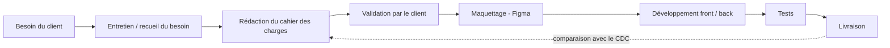

# Le cahier des charges

## Résumé
Le cahier des charges est le document qui décrit ce que le client attend d'un projet : objectifs, utilisateurs, fonctionnalités, contraintes, livrables et planning. Il est rédigé avant le développement. Il sert de référence commune entre le client et l'équipe pour valider le travail livré.

## Définitions clés
- **Cahier des charges (CDC)** : document qui formalise le besoin du client et les conditions de réalisation du projet.
- **Client / commanditaire (MOA, maîtrise d'ouvrage)** : la personne ou l'entreprise qui commande le projet et exprime le besoin.
- **Prestataire (MOE, maîtrise d'œuvre)** : celui qui réalise le projet (développeur, agence).
- **Besoin fonctionnel** : ce que l'application doit faire (ex. s'inscrire, se connecter).
- **Besoin non fonctionnel** : comment l'application doit se comporter (ex. rapidité, sécurité, accessibilité, compatibilité mobile).
- **Contrainte** : limite imposée au projet (budget, délai, technologie, charte graphique, RGPD).
- **Livrable** : élément concret remis au client (maquettes, code source, base de données, documentation).
- **Cible / persona** : profil type d'un utilisateur de l'application.
- **User story** : besoin exprimé sous la forme « En tant que [utilisateur], je veux [action] afin de [objectif] ».
- **MoSCoW** : méthode de priorisation (Must, Should, Could, Won't have).

## Pourquoi rédiger un cahier des charges
1. Éviter les malentendus entre client et prestataire.
2. Fixer le périmètre : ce qui est inclus et ce qui ne l'est pas.
3. Estimer le temps, le coût et les ressources.
4. Répartir les tâches dans l'équipe.
5. Disposer d'un critère de validation à la livraison.

## Schéma : place du cahier des charges dans un projet



## Procédure : rédiger un cahier des charges

### Étape 1 : recueillir le besoin
1. Organiser un entretien avec le client.
2. Poser les questions : quel problème résoudre ? pour qui ? dans quel contexte ?
3. Collecter l'existant : site actuel, logo, charte graphique, concurrents.
4. Reformuler le besoin par écrit et le faire valider.

### Étape 2 : structurer le document
Plan type :
1. Présentation du projet et du contexte
2. Objectifs
3. Cibles (utilisateurs)
4. Périmètre (inclus / exclus)
5. Besoins fonctionnels
6. Besoins non fonctionnels
7. Contraintes
8. Arborescence et parcours utilisateur
9. Livrables
10. Planning et budget
11. Critères de validation

### Étape 3 : rédiger chaque partie
- Phrases courtes, vocabulaire précis, pas d'ambiguïté.
- Une exigence = une phrase vérifiable (mesurable, testable).
- Prioriser chaque fonctionnalité avec MoSCoW.

### Étape 4 : faire valider
1. Relire avec le client.
2. Corriger les points flous.
3. Faire signer ou valider par écrit (date + version).
4. Versionner le document (v1.0, v1.1…) et le stocker sur Git.

## Modèle Markdown 

```markdown
# Cahier des charges – [Nom du projet]
Version : 1.0 | Date : JJ/MM/AAAA | Auteur : [Nom]

## 1. Contexte
[Qui est le client, quelle est son activité, pourquoi ce projet]

## 2. Objectifs
- Objectif 1 (mesurable)
- Objectif 2

## 3. Cibles
| Persona | Âge | Besoin | Appareil principal |
|---|---|---|---|

## 4. Périmètre
- Inclus :
- Exclu :

## 5. Besoins fonctionnels
| ID | User story | Priorité (MoSCoW) |
|---|---|---|

## 6. Besoins non fonctionnels
- Performance, sécurité, accessibilité, responsive, SEO

## 7. Contraintes
- Budget, délai, technologies, charte graphique, RGPD

## 8. Livrables
- [ ] Maquettes
- [ ] Code source
- [ ] Base de données
- [ ] Documentation

## 9. Planning
| Phase | Début | Fin |
|---|---|---|

## 10. Critères de validation
- [ ] Critère 1 vérifiable
```


## Liens
[[Git et GitHub]] · [[<>Markdown]] · [[Maquettage Figma]] · [[Wireframes]] · [[RGPD]] · [[Accessibilité RGAA]] · [[Méthode Agile]] · [[User stories]]
