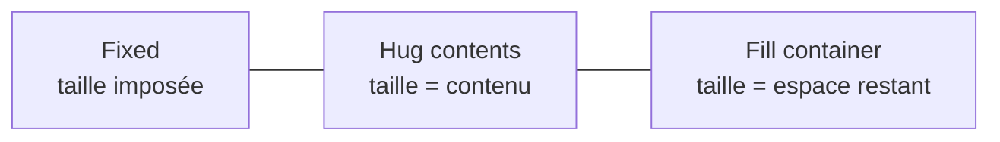
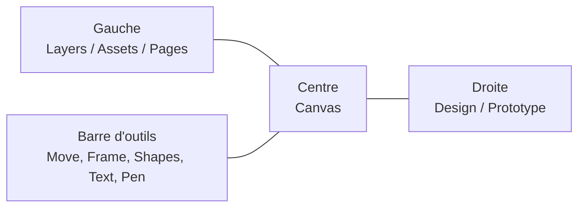

## Résumé
Figma sert à dessiner les pages d'un site (maquette) puis à les relier pour simuler la navigation (prototype). Chaque écran est un **Frame**. Les réglages de rangement (**Auto layout**) fonctionnent comme le Flexbox en CSS : apprendre les deux ensemble permet de retenir les termes une seule fois.

## Glossaire anglais → français

### Structure
| Anglais (Figma) | Français | Définition |
|---|---|---|
| Canvas | Canevas | Zone de travail infinie |
| Frame | Cadre | Conteneur = un écran ou un bloc (`F`) |
| Layer | Calque | Chaque élément, listé à gauche |
| Group | Groupe | Regroupe des calques (sans règles de rangement) |
| Page | Page | Onglet du fichier (ex. Wireframes, Maquettes) |
| Section | Section | Zone d'organisation du canevas |
| Component | Composant | Élément réutilisable |
| Main component | Composant principal | Le modèle |
| Instance | Instance | Copie liée au modèle |
| Variant | Variante | Version d'un composant (Normal, Hover…) |
| Styles | Styles | Couleurs, textes, effets enregistrés |
| Variables | Variables | Valeurs enregistrées (couleurs, nombres) |
| Assets | Ressources | Panneau listant les composants et styles |

### Panneau Design (réglages)
| Anglais | Français | Équivalent CSS |
|---|---|---|
| Fill | Remplissage (couleur de fond) | `background-color` |
| Stroke | Contour | `border` |
| Effects | Effets | – |
| Drop shadow | Ombre portée | `box-shadow` |
| Layer blur | Flou | `filter: blur()` |
| Corner radius | Rayon des angles | `border-radius` |
| Opacity | Opacité | `opacity` |
| Font | Police | `font-family` |
| Size | Taille | `font-size` |
| Weight | Graisse | `font-weight` |
| Line height | Interligne | `line-height` |
| Letter spacing | Espacement des lettres | `letter-spacing` |
| Text align | Alignement du texte | `text-align` |
| W / H (Width / Height) | Largeur / Hauteur | `width` / `height` |
| X / Y | Position horizontale / verticale | – |
| Rotation | Rotation | `transform: rotate()` |
| Clip content | Masquer ce qui dépasse | `overflow: hidden` |

### Outils (barre d'outils)
| Anglais | Français | Raccourci |
|---|---|---|
| Move | Déplacer | `V` |
| Frame | Cadre | `F` |
| Rectangle / Ellipse / Line / Arrow | Rectangle / Ellipse / Ligne / Flèche | `R` / `O` / `L` / `Shift+L` |
| Text | Texte | `T` |
| Pen | Plume (tracé vectoriel) | `P` |
| Hand tool | Main (se déplacer sur le canevas) | `H` |
| Comment | Commentaire | `C` |
| Boolean operations (Union, Subtract, Intersect, Exclude) | Opérations booléennes | – |
| Mask | Masque | – |
| Align / Distribute | Aligner / Répartir | – |

## Layout grid, Auto layout, Constraints : trois choses différentes

| Terme | Français | Rôle | Équivalent CSS |
|---|---|---|---|
| **Layout grid** | Grille de mise en page | Colonnes **visibles en repère** sur le Frame ; ne range rien automatiquement | Grille de colonnes (CSS Grid / 12 colonnes) |
| **Auto layout** | Mise en page automatique | **Range automatiquement** les éléments d'un Frame | `display: flex` |
| **Constraints** | Contraintes | Comportement d'un élément quand le Frame change de taille | `position` + règles responsive |

À retenir : Layout grid = repère de colonnes ; Auto layout = rangement automatique.

## Réglages de l'Auto layout (`Shift + A`)

| Anglais (Figma) | Français | Équivalent CSS |
|---|---|---|
| Direction : Vertical / Horizontal | Direction | `flex-direction: column` / `row` |
| **Gap between items** (gap) | Espacement entre les éléments | `gap` |
| **Padding** (horizontal / vertical) | Marge intérieure du Frame | `padding` |
| Alignment (grille de 9 points) | Alignement | `justify-content` / `align-items` |
| Wrap | Retour à la ligne | `flex-wrap: wrap` |
| Absolute position | Position absolue (sort l'élément du rangement) | `position: absolute` |

### Gap vs Padding

```
┌──────────── Frame ────────────┐
│ ← padding (bord → contenu)    │
│    [ Élément A ]              │
│         ↕ gap (entre A et B)  │
│    [ Élément B ]              │
│                               │
└───────────────────────────────┘
```

- **Padding** : espace entre le bord du Frame et son contenu.
- **Gap** : espace entre deux éléments voisins, à l'intérieur du Frame.
- Figma n'a pas de « margin » : l'espace extérieur se règle avec le gap ou le padding du Frame parent.

### Fixed, Hug, Fill : la taille d'un élément (champs Width / Height)

| Anglais | Français | Comportement | Équivalent CSS |
|---|---|---|---|
| **Fixed** (width/height) | Taille fixe | Valeur imposée (ex. 300 px) | `width: 300px` |
| **Hug contents** | Ajusté au contenu | Taille = contenu + padding | `width: fit-content` / `auto` |
| **Fill container** | Remplit le conteneur | Prend tout l'espace disponible dans le Frame parent | `flex: 1` / `width: 100%` |



### Deux « Fill » différents
- **Fill** (panneau Design) = couleur de remplissage → `background-color`.
- **Fill container** (Auto layout) = taille qui remplit le parent → `flex: 1`.

## Prototype (onglet **Prototype**)

| Anglais | Français |
|---|---|
| Interaction | Interaction |
| Trigger (On click, On hover, While pressing…) | Déclencheur (au clic, au survol, pendant l'appui) |
| Action (Navigate to, Open overlay, Back…) | Action (aller à, ouvrir une fenêtre superposée, retour) |
| Animation (Instant, Dissolve, Smart animate, Move in…) | Animation (instantanée, fondu, animation intelligente, glissement) |
| Flow starting point | Point de départ du parcours |
| Present (▶) | Présenter / lancer le prototype |
| Share | Partager |
| Dev Mode | Mode développeur (relevé des valeurs, CSS) |
| Export | Exporter |

## Interface (où trouver quoi)



## Raccourcis (Linux : `Ctrl`)

| Action | Raccourci |
|---|---|
| Frame | `F` |
| Dupliquer (Duplicate) | `Ctrl + D` |
| Grouper / Dégrouper | `Ctrl + G` / `Ctrl + Shift + G` |
| Mettre en Frame (Frame selection) | `Ctrl + Alt + G` |
| Auto layout | `Shift + A` |
| Créer un composant | `Ctrl + Alt + K` |
| Zoom sur la sélection / tout voir | `Shift + 2` / `Shift + 1` |
| Afficher les grilles (Layout grids) | `Ctrl + Shift + 4` |
| Mesurer les distances | maintenir `Alt` en survolant |
| Annuler | `Ctrl + Z` |

## Procédure : créer une maquette de site web
1. Créer le fichier (New design file) et le nommer.
2. Créer les Pages : `Wireframes`, `Maquettes`, `Composants`, `Prototype`.
3. Créer les Frames (`F`) :
   - Desktop : 1440 × 1024
   - Tablette : 768 × 1024
   - Mobile : 375 × 812
4. Ajouter une **Layout grid** (bouton `+` du panneau Design) : 12 colonnes desktop, 8 tablette, 4 mobile.
5. Poser la structure en wireframe (rectangles gris, textes provisoires).
6. Enregistrer les **Styles** (couleurs, typographies).
7. Créer les **Components** (bouton, champ, carte, en-tête, pied de page).
8. Assembler les pages avec des **Instances**.
9. Décliner en tablette et mobile.
10. Relire : alignements, espacements, contrastes.

## Procédure : Auto layout
1. Sélectionner les éléments ou le Frame → `Shift + A`.
2. Choisir la **Direction** (Vertical ou Horizontal).
3. Régler le **Gap** (espace entre éléments).
4. Régler le **Padding** (espace bord → contenu).
5. Régler la taille de chaque élément : **Fixed**, **Hug contents** ou **Fill container**.
6. Régler l'**Alignment** (grille de 9 points).

## Procédure : composant avec variantes (ex. bouton)
1. Dessiner un rectangle + un texte.
2. Sélectionner les deux → `Shift + A` → Padding : 12 vertical / 24 horizontal.
3. Régler le **Corner radius**, appliquer les **Styles** de couleur et de texte.
4. `Ctrl + Alt + K` pour créer le **Component**.
5. **Add variant** : créer `Normal`, `Hover`, `Disabled`.
6. Nommer la propriété (ex. `State`) et les valeurs.
7. Utiliser les **Instances** depuis le panneau **Assets**.

## Procédure : prototype
1. Onglet **Prototype** (panneau droit).
2. Sélectionner l'élément cliquable.
3. Tirer le point bleu vers le Frame de destination.
4. Régler **Trigger** (On click), **Action** (Navigate to), **Animation** (Instant, Smart animate…).
5. Définir le **Flow starting point**.
6. Lancer avec **Present** (▶) et tester le parcours.

## Procédure : exporter (Export)
1. Sélectionner l'élément → section **Export** (panneau droit).
2. Choisir le format : PNG (image avec transparence), JPG (photo), SVG (icône, logo).
3. Choisir l'échelle (1x, 2x) et nommer le fichier (`logo-header.svg`).
4. Partager : bouton **Share** (lien View ou Edit).

## Bonnes pratiques
- Nommer les calques (`Header`, `Hero`, `Card-produit`).
- Utiliser Auto layout, Styles et Components dès le départ.
- Espacements multiples de 8 (8, 16, 24, 32).
- Texte : 16 px minimum, contraste suffisant (RGAA / WCAG).
- Wireframe en gris d'abord, maquette ensuite.

## Pièges courants
- Confondre **Layout grid** (repère de colonnes) et **Auto layout** (rangement).
- Confondre **Gap** (entre éléments) et **Padding** (bord → contenu).
- Confondre **Fill** (couleur) et **Fill container** (taille).
- Dessiner sans Frame.
- Copier-coller un bouton au lieu d'utiliser une Instance.
- Modifier une Instance au lieu du Main component.
- Laisser des noms de calques `Rectangle 47`.

## Compétence du référentiel
Bloc 4 – Design d'interfaces : wireframes, maquettes Figma, prototypes multi-supports, accessibilité, export des assets.

## Liens
[[UX-UI]] · [[Wireframe]] · [[CSS Flexbox]] · [[CSS responsive]] · [[Accessibilité RGAA]]
