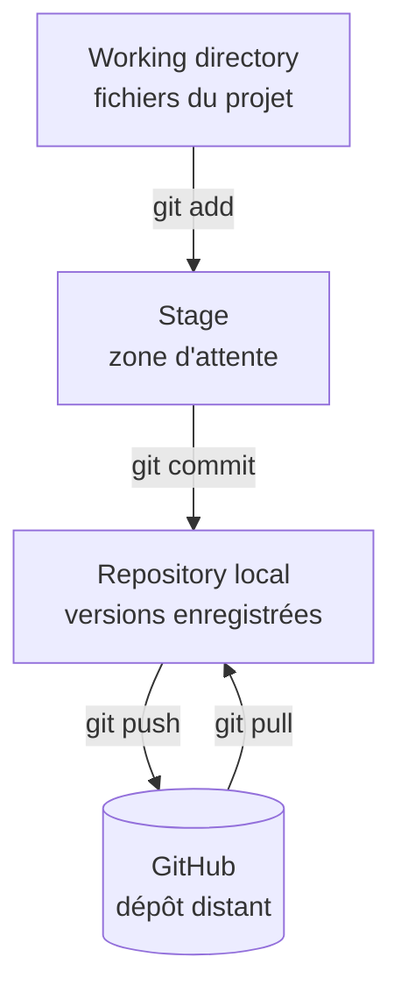
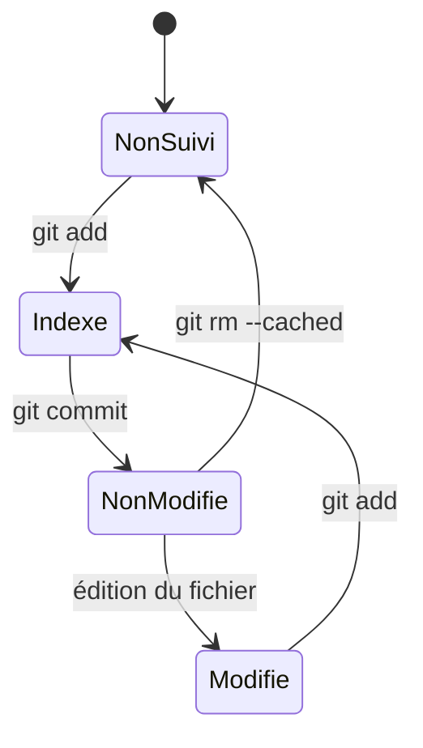
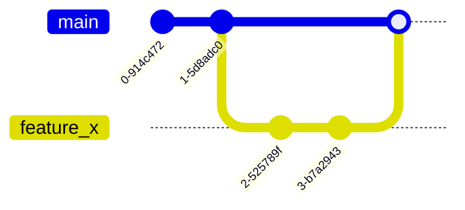

---
tags:
  - git
  - github
  - linux
  - versioning
  - procedure
---
# Git et GitHub 

## Résumé
Git est un outil installé sur l'ordinateur qui conserve l'historique d'un projet (quoi, quand, qui) et permet de revenir à une version précédente. GitHub est une plateforme en ligne qui héberge une copie du projet : elle sert de sauvegarde et de lieu de partage entre développeurs. Le travail se fait en local avec Git, puis la synchronisation avec GitHub se fait par `push` et `pull`.


## Définitions clés
- **Versioning** : suivi des versions successives des fichiers.
- **Dépôt (repository, repo)** : dossier dont Git conserve tout l'historique.
- **Dépôt local** : sur la machine, créé et géré par Git.
- **Dépôt distant (remote)** : hébergé en ligne (GitHub), sert de sauvegarde et de centralisation.
- **Working directory** : dossier du projet, où les fichiers sont modifiés.
- **Stage / index** : zone d'attente qui liste les fichiers de la prochaine version.
- **Commit** : version enregistrée localement, avec un message.
- **Branche** : ligne de développement parallèle (`main`, ancien nom `master`).
- **HEAD** : pointeur vers la branche et le commit courants.
- **Merge** : fusion d'une branche dans une autre.
- **origin** : nom habituel du dépôt distant.


## Schéma : les 3 zones locales et GitHub


## Procédure 1 : installer et configurer Git (Ubuntu)
1. Installer Git :
```bash
sudo apt install git
```
2. Vérifier l'installation (affiche le numéro de version) :
```bash
git -v
```
3. Définir `main` comme nom de la branche principale (cohérent avec GitHub) :
```bash
git config --global init.defaultBranch main
```
4. Choisir l'éditeur utilisé pour les messages de commit :
```bash
git config --global core.editor vi     # recommandé par le cours
git config --global core.editor code   # ou Visual Studio Code
```
5. Renseigner l'identité (indispensable) :
```bash
git config --global user.name "Prénom Nom"
git config --global user.email "adresse@exemple.com"
```
6. Vérifier une valeur (même commande, sans la valeur) :
```bash
git config --global user.email
```
`--global` : le réglage vaut pour tous les dépôts de la machine.

## Procédure 2 : créer un compte GitHub
1. Aller sur https://github.com/ puis cliquer sur **Sign up**.
2. Saisir l'email, le mot de passe et le nom d'utilisateur, puis valider.
3. Confirmer l'adresse via l'email reçu.
4. Choisir : nombre de participants **10 à 20**, statut **étudiant**, centres d'intérêt (facultatif, déconseillé), **plan gratuit**.
5. Arrivée sur le **Dashboard** : explorer le menu général (profil, dépôts, GitHub Docs).

## Procédure 3 : créer un dépôt local
**Cas A : nouveau projet**
```bash
mkdir mon_projet && cd mon_projet   # créer le dossier et s'y placer
git init                            # crée le dossier caché .git (dépôt vide)
```
**Cas B : récupérer un dépôt existant**
```bash
git clone https://github.com/compte/projet.git   # un dossier "projet" est créé
git clone git@github.com:compte/projet.git        # variante SSH
```

## Procédure 4 : cycle de travail quotidien
```bash
git status                           # état du dépôt (à utiliser à tout instant)
git add fichier.html                 # mettre dans le stage (ou un dossier : git add images/)
git commit -m "Ajout de la page accueil"   # enregistrer une version locale
git log                              # historique, du plus récent au plus ancien
git push                             # envoyer sur GitHub
git pull                             # récupérer les modifications des autres
```
- Retirer un fichier du stage **sans le détruire** : `git rm --cached fichier`
- Sans `-m`, l'éditeur configuré s'ouvre pour écrire le message : enregistrer puis fermer pour créer le commit.
- Faire des commits fréquents, avec un message qui décrit ce que fait la modification.

## Procédure 5 : premier push vers GitHub
1. Sur GitHub, créer un dépôt **vide** (sans README).
2. Dans le dépôt local :
```bash
git remote add origin https://github.com/mon_nom/mon_projet.git   # lier local et distant
git branch -M main                                                 # nom de branche identique
git push -u origin main                                            # -u mémorise dépôt + branche
```
3. Ensuite, un simple `git push` suffit.
4. Retrouver le lien enregistré : `git remote show origin`

## Procédure 6 : partir du dépôt d'un autre et le rattacher à son compte
1. Se placer là où le dossier doit être créé, puis cloner : `git clone <lien_du_depot_source>`
2. Créer sur son compte GitHub un dépôt **vide** et copier son lien.
3. Se placer à la racine du dépôt local.
4. Changer la cible, puis pousser :
```bash
git remote set-url origin <mon_lien>
git push
```

## Choix du protocole d'accès
| | HTTPS | SSH |
|---|---|---|
| Lien | `https://github.com/compte/projet.git` | `git@github.com:compte/projet.git` |
| Configuration | aucune | création de clés SSH |
| À l'usage | identification à chaque push | confortable, plus sécurisé |
| Tendance | en voie de disparition | recommandé |

## Les 4 états d'un fichier

- **Non suivi** : Git ne gère pas le fichier.
- **Non modifié** : enregistré tel quel dans le dépôt.
- **Modifié** : changé depuis le dernier commit.
- **Indexé** : sera inclus dans le prochain commit.

## Procédure 7 : travailler avec une branche
Objectif : tester une évolution sans toucher à la version stable.
```bash
git branch feature_x      # créer la branche
git checkout feature_x    # basculer dessus (HEAD se déplace)
# ... modifications, add, commit ...
git checkout main         # revenir à la branche principale
git merge feature_x       # fusionner feature_x DANS la branche active
git branch -d feature_x   # supprimer la branche devenue inutile
```


## Procédure 8 : résoudre un conflit de fusion
Cause : la même partie du même fichier a été modifiée différemment dans les deux branches.
1. Git met la fusion en pause : `git status` liste les fichiers « unmerged ».
2. Ouvrir chaque fichier concerné et choisir à la main le contenu à garder.
3. Marquer comme résolu : `git add fichier`
4. Terminer la fusion : `git commit`

## Pièges courants
- `user.name` et `user.email` non définis : Git refuse de committer.
- `vi` s'ouvre et ne se ferme pas : touche `i` pour écrire, puis `Échap`, puis `:wq` et Entrée.
- `git commit` sans `git add` préalable : rien n'est enregistré, seul le stage est validé.
- `git commit -a` n'ajoute **pas** les fichiers neufs : un premier `git add` reste nécessaire.
- `git rm fichier` **détruit** le fichier, alors que `git rm --cached fichier` le garde.
- Dépôt GitHub créé avec un README alors qu'un dépôt local existe déjà : conflit d'historique, créer le dépôt vide.
- Commit confondu avec push : un commit reste local tant que `git push` n'a pas été fait.
- Noms de branche différents entre local et distant : `git branch -M main`.
- Messages de commit vagues (« modif ») : décrire ce que fait le commit.


## Liens
[[Linux commandes de base]] · [[Markdown]] · [[Mermaid]] · [[Branches Git (partie 2)]] · [[Pull request]]

