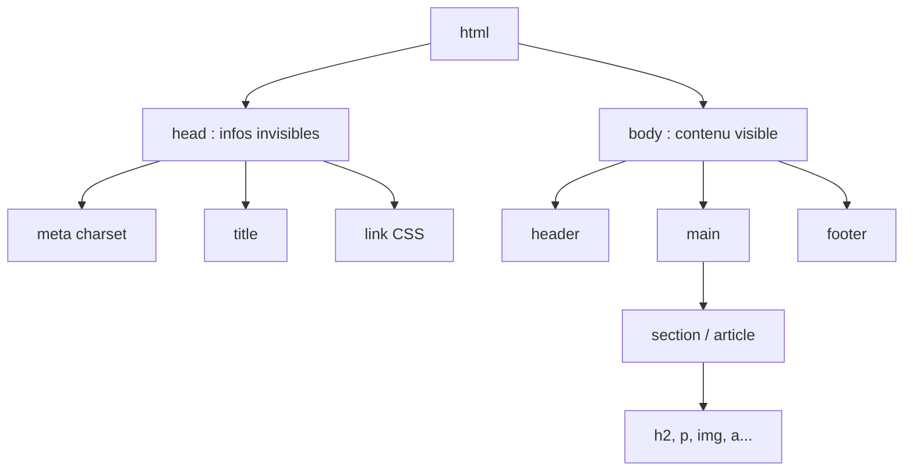

## Résumé
HTML est le langage qui décrit **le contenu et la structure** d'une page (titres, paragraphes, images, liens). Il ne s'occupe pas de l'apparence : c'est le rôle du CSS. Une page HTML est un simple fichier texte `.html` lu par le navigateur.

## Définitions clés
- **HTML** (HyperText Markup Language) : langage de balisage qui structure une page.
- **Balise** : mot entre chevrons, ex. `<p>`. Souvent par paire : ouvrante `<p>` et fermante `</p>`.
- **Élément** : balise ouvrante + contenu + balise fermante.
- **Attribut** : info ajoutée dans la balise ouvrante, ex. `href="..."`.
- **Balise orpheline** : sans fermeture, ex. ``, `<br>`.
- **Sémantique** : choisir la balise selon le **sens** du contenu (`<nav>` pour un menu), pas selon son apparence.
- **Navigateur** : logiciel qui lit le HTML et affiche la page (Firefox, Chrome).

## Schéma : structure d'une page



## Procédure

### 1. Préparer le dossier du projet (terminal Ubuntu)
```bash
mkdir -p ~/projets/mon-site     # crée le dossier (-p : crée aussi les dossiers parents)
cd ~/projets/mon-site           # entre dans le dossier
touch index.html                # crée un fichier vide
code .                          # ouvre le dossier dans VSCode
```
- Le fichier d'accueil d'un site s'appelle toujours `index.html`.
- Pas d'espaces ni d'accents dans les noms de fichiers.

### 2. Écrire le squelette
Dans `index.html` : taper `!` puis `Tab` (raccourci Emmet de VSCode), ou écrire :

```html
<!DOCTYPE html>                      <!-- indique au navigateur : HTML5 -->
<html lang="fr">                     <!-- langue de la page (accessibilité + SEO) -->
<head>
  <meta charset="UTF-8">             <!-- accents corrects -->
  <meta name="viewport" content="width=device-width, initial-scale=1.0"> <!-- responsive -->
  <title>Mon premier site</title>    <!-- titre de l'onglet, important pour le SEO -->
</head>
<body>
  <!-- tout le contenu visible va ici -->
</body>
</html>
```

### 3. Remplir le body avec des balises sémantiques
```html
<body>
  <header>
    <h1>Mon portfolio photo</h1>            <!-- UN seul h1 par page -->
    <nav>
      <ul>
        <li><a href="index.html">Accueil</a></li>
        <li><a href="contact.html">Contact</a></li>
      </ul>
    </nav>
  </header>

  <main>                                    <!-- contenu principal, un seul par page -->
    <section>
      <h2>Mes séries</h2>
      <p>Texte de présentation.</p>
      
    </section>
  </main>

  <footer>
    <p>© 2026 — Mentions légales</p>
  </footer>
</body>
```

### 4. Visualiser le résultat
```bash
xdg-open index.html     # ouvre la page dans le navigateur par défaut
```
Ensuite : modifier dans VSCode → enregistrer (`Ctrl+S`) → actualiser le navigateur (`F5`).

### 5. Vérifier la validité
- Coller le code sur https://validator.w3.org (onglet « Validate by direct input »).
- Corriger les erreurs en commençant par la première.

## ATTENTION:
- Oublier de fermer une balise (`</p>`) → la mise en page se décale.
- Mal imbriquer : `<p><strong>texte</p></strong>` ✗ → `<p><strong>texte</strong></p>` ✓.
- Plusieurs `<h1>` ou sauter des niveaux (h1 → h4).
- `` sans `alt` (accessibilité + SEO).
- Utiliser `<br>` ou des `<div>` partout au lieu de balises sémantiques.
- Chemin d'image faux (majuscules/minuscules comptent sous Linux : `Photo.JPG` ≠ `photo.jpg`).
- Fichier non enregistré (point blanc sur l'onglet VSCode).


## Liens
[[HTML - Mémo balises]] · [[CSS - Procédure]] · [[Linux - Commandes de base]] · [[Git - Procédure]]
