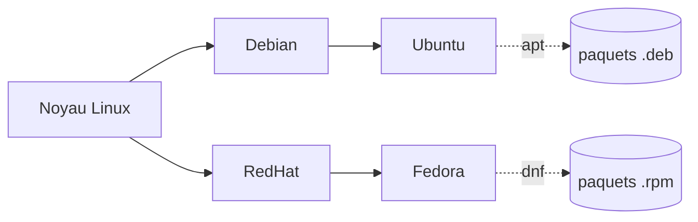
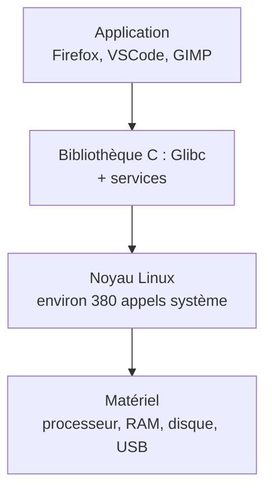
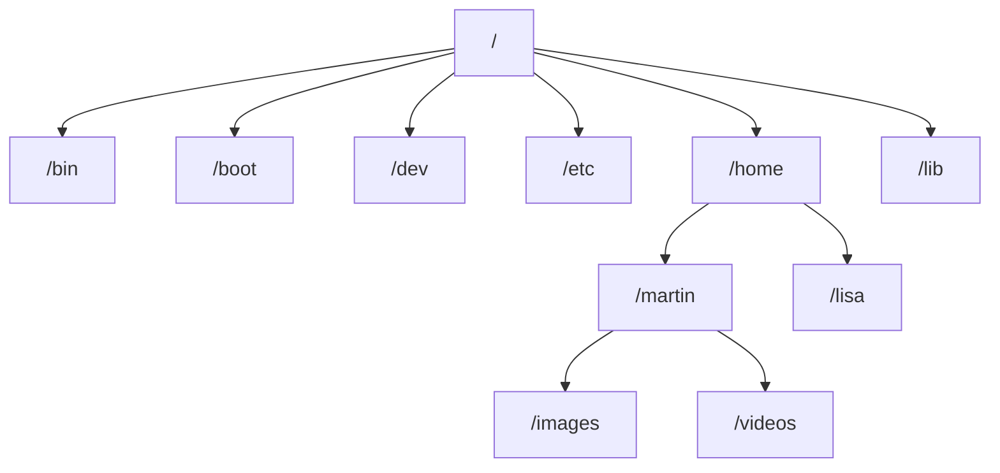
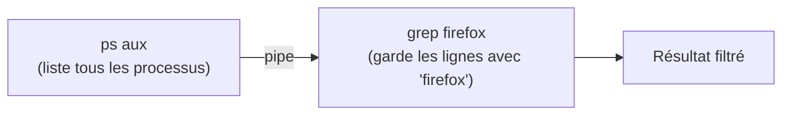

---
tags:
  - linux
  - ubuntu
  - terminal
  - bash
  - droits
  - apt
  - systemctl
  - ssh
  - formation-greta
date: 2026-11-02
cours: Linux – Introduction et premiers pas (Thierry Bouedo, nov. 2026)
---

# Linux – Introduction et premiers pas

#linux #ubuntu #terminal #bash #droits #apt #systemctl #ssh

> **Résumé** : Linux est un système d'exploitation **libre**, construit autour d'un **noyau** (le « cerveau » qui parle au matériel) et des outils du projet **GNU**. On l'utilise surtout en **ligne de commande** (le terminal) : on tape des ordres courts pour naviguer, gérer des fichiers, des droits, des logiciels et des services. C'est le socle de presque tous les serveurs web, donc de tout ton futur métier (PHP, Docker, déploiement…).

👉 Mémo des commandes : [[Linux_memo_commandes]]

---

## Les mots à connaître avant de commencer

| Terme                           | Définition simple                                                                                           |
| ------------------------------- | ----------------------------------------------------------------------------------------------------------- |
| **Système d'exploitation (OS)** | Le logiciel de base qui fait le lien entre toi, les programmes et le matériel (Windows, macOS, Linux…).     |
| **Noyau (kernel)**              | Le cœur de l'OS : il distribue la mémoire, le processeur, le disque aux programmes.                         |
| **Terminal / shell**            | La fenêtre où l'on tape des commandes. Le *shell* est le programme qui les comprend (ici : bash).           |
| **Commande**                    | Un ordre écrit : `ls`, `cd`, `cp`… Souvent suivi d'**options** (`-l`) et d'**arguments** (le fichier visé). |
| **Répertoire**                  | Un dossier.                                                                                                 |
| **Arborescence**                | L'organisation de tous les dossiers en « arbre » à partir de la racine `/`.                                 |
| **Chemin (path)**               | L'adresse d'un fichier dans l'arborescence : `/home/lisa/notes.txt`.                                        |
| **Paquet (package)**            | Un logiciel prêt à installer, avec ses dépendances.                                                         |
| **Processus**                   | Un programme en cours d'exécution. Il a un numéro : le **PID**.                                             |
| **Service / daemon (démon)**    | Un processus qui tourne en tâche de fond, en permanence (ex. serveur web).                                  |
| **root**                        | Le super-utilisateur : il a tous les droits. On l'emprunte avec `sudo`.                                     |

> **Analogie photo** : le noyau = le **boîtier** de l'appareil (il pilote tout). Les **modules** = les **objectifs** qu'on monte ou démonte selon le besoin. Les programmes = les **applis de retouche** qui s'appuient sur le boîtier.

---

## 1. Historique (le « pourquoi » de Linux)

| Date | Événement |
|---|---|
| Début 1970 | **Unix** créé par AT&T, utilisé dans les universités. |
| 1977 | Université de Californie (Berkeley) améliore Unix → **BSD** (*Berkeley Software Distribution*), libre de code AT&T en 1991. |
| 1983 | **Richard Stallman** lance **GNU** (*GNU is Not Unix*) : un système libre compatible Unix. 1985 : le compilateur **GCC** existe. |
| ~1990 | GNU travaille sur le noyau **Hurd**… qui prendra plus de dix ans. |
| 1991 | **Linus Torvalds** développe un noyau : le **noyau Linux**, publié sous licence **GNU GPL**. |
| Ensuite | Noyau Linux + outils GNU = système complet **GNU/Linux** (« Linux »). |

**À retenir** : Linux = la « pièce manquante » du puzzle GNU.

### Philosophie

1. **Logiciel libre** (défini par la licence **GPL**) - 4 libertés : **utiliser, étudier, modifier, redistribuer** (sous conditions GPL). Indépendance vis-à-vis d'un éditeur, entraide et partage.
2. **Interopérabilité** - protocoles standardisés (Internet), **formats ouverts** (spécifications publiques) pour ne pas dépendre d'un seul logiciel. Exemple : **Apache**, serveur web de référence.
3. **Communauté** - nombreux groupes de développement et de promotion.

> 💡 Analogie RH : un logiciel libre, c'est un **référentiel de compétences public** que tout le monde peut lire, adapter et partager, au lieu d'un document confidentiel d'un seul employeur.

---

## 2. Les distributions

Une **distribution** = une solution **prête à installer** qui assemble :

- le noyau Linux
- + le système GNU
- + des programmes d'installation et d'administration
- + un **gestionnaire de paquets** (APT, YUM/DNF)
- + une sélection de logiciels d'autres développeurs

Exemples : **Debian, Ubuntu**, **RedHat / Fedora / CentOS**, Slackware (historique).

Ce qui varie d'une distribution à l'autre :
- niveaux de support différents ;
- **2 grandes familles de gestionnaires de paquets** : `apt` (Debian/Ubuntu) et `dnf`/`yum` (RedHat/Fedora) ;
- **2 grandes familles de gestion des services** ;
- plusieurs **environnements de bureau** (Gnome, KDE…).



---

## 3. Structure du système

### 3.1 Architecture en « couches »

Pourquoi des couches ? **Modularité** → maintenance, évolution, portabilité ; **développement collaboratif** → fiabilité.



- Une application ne parle **jamais directement** au matériel : elle passe par le noyau via des **appels système** (*System Call Interface*, environ 380).
- Le noyau est lui-même découpé en **modules** : gestionnaire de mémoire, ordonnanceur de processus, système de fichiers virtuel, interface réseau, interface d'entrées/sorties, communication entre processus (IPC).
- Le noyau Linux fonctionne sur des machines très variées : supercalculateurs, PC, smartphones, objets embarqués…

### 3.2 Gestion des modules du noyau

Les modules sont des **briques** qu'on peut charger/décharger sans redémarrer.

- Où ? `/lib/modules/` + version du noyau, obtenue avec `uname -r` (Thierry écrit ``/lib/modules/`uname -r` ``).
- Lister : `lsmod` (équivaut à lire `/proc/modules`).
- Catégories de dossiers :

| Dossier    | Contenu                                           |
| ---------- | ------------------------------------------------- |
| `arch/`    | processeurs, cryptographie, kvm                   |
| `fs/`      | systèmes de fichiers (fat, ext4, btrfs…)          |
| `sound/`   | son                                               |
| `video/`   | vidéo                                             |
| `kernel/`  | modules liés au noyau (kheaders…)                 |
| `crypto/`  | cryptographie et encodage                         |
| `drivers/` | pilotes, un sous-dossier par type de périphérique |

- Charger : `sudo insmod /lib/modules/$(uname -r)/kernel/<dir>/<nom>.ko`
- Retirer : `sudo rmmod <nom>`

### 3.3 Capturer des informations

**Hardware (matériel)**

| Commande / fichier  | Rôle                                                             |
| ------------------- | ---------------------------------------------------------------- |
| `lspci`             | périphériques du bus PCI (bas niveau : adresses, interruptions…) |
| `cat /proc/meminfo` | utilisation de la mémoire vive (RAM)                             |
| `cat /proc/cpuinfo` | infos sur le(s) processeur(s)                                    |
| `cat /proc/devices` | périphériques installés (plus haut niveau que `lspci`)           |
| `df -m` ou `df -k`  | état des disques et partitions                                   |

> Le dossier **`/proc`** est un dossier « virtuel » : il n'existe pas sur le disque, c'est une **fenêtre** que le noyau ouvre sur son état. Il contient autant de sous-dossiers que de processus. Le même `cat` fonctionne pour tout `/proc/...`.

**Software (logiciels en cours d'exécution)**  Ça ne liste **pas** ce qui est installé (c'est le rôle de la gestion des paquets).

| Commande | Rôle |
|---|---|
| `top` | tous les processus : PID, nom, CPU, mémoire, durée… (en direct) |
| `ps aux` | état des applications, **avec le propriétaire** (plus lisible que `top`) |

Ces deux commandes sont des versions plus conviviales de la lecture de `/proc`.

---

## 4. Le système de fichiers

### 4.1 Navigation

**Pourquoi ?** Sous Linux, **tout est fichier** et tout part d'une **racine unique** `/`. Pas de `C:` ni `D:`.



Rôle des dossiers principaux (repères courants) :

| Dossier | Contient |
|---|---|
| `/bin` | programmes de base (commandes) |
| `/boot` | fichiers de démarrage |
| `/dev` | périphériques (représentés par des fichiers) |
| `/etc` | fichiers de **configuration** du système |
| `/home` | dossiers personnels des utilisateurs |
| `/lib` | bibliothèques et modules du noyau |
| `/proc` | état du noyau et des processus (virtuel) |
| `/var/www/html` | racine du serveur web Apache (voir §6) |

**Commandes**

- `pwd` : **où suis-je ?** (affiche le répertoire courant)
- `ls` ou `ls -al` : contenu du répertoire (`-l` = détails, `-a` = fichiers cachés)
- `cd <chemin>` : changer de dossier

**Chemins**

| Type | Exemple | Explication |
|---|---|---|
| **Relatif** | `cd martin/images` ou `cd ./martin/images` | part d'**où je suis** (`.` = ici) |
| **Absolu** | `cd /home/lisa` | part de la racine `/`, marche de partout |
| **Vers l'arrière** | `cd ..` / `cd ../videos` / `cd ../../lisa` | `..` = dossier parent |

> Analogie : chemin **absolu** = adresse postale complète ; chemin **relatif** = « la deuxième porte à gauche depuis ici ».

⚠️ **Linux est sensible à la casse** : `Photo.jpg` ≠ `photo.jpg`.

### 4.2 Manipulation des fichiers

**Créer / supprimer**

| Action                              | Commande          | Note                                                                    |
| ----------------------------------- | ----------------- | ----------------------------------------------------------------------- |
| Créer un dossier                    | `mkdir <dossier>` | plusieurs d'un coup : `mkdir d1 d2` ; `-p` crée tout le chemin manquant |
| Supprimer un dossier **vide**       | `rmdir <dossier>` |                                                                         |
| Créer un fichier vide               | `touch <fichier>` |                                                                         |
| Supprimer un fichier                | `rm <fichier>`    | **définitif**, pas de corbeille                                         |
| Supprimer un dossier et son contenu | `rm -r <dossier>` | récursif, à manier avec prudence                                        |

**Jokers (wildcards)** : `*` remplace « n'importe quoi ». `rm image*.jpg` efface tous les fichiers du dossier courant dont le nom commence par `image` et finit par `.jpg`.

**Copier, déplacer, renommer**

Exemple du cours, depuis le dossier `users` :

```
users
├── martin
│   ├── images
│   └── audio
│       ├── blues      (music001.mp3, music002.mp3)
│       └── classique
└── lisa
    └── multimedia
```

```bash
# COPIER : cp <source> <destination>
cp martin/audio/blues/music002.mp3 lisa/multimedia

# Même résultat en se plaçant d'abord dans le dossier (chemin relatif)
cd martin/audio
cp blues/music002.mp3 ../../lisa/multimedia

# DÉPLACER : mv <source> <destination>  (marche aussi sur les dossiers, sans -r)
mv martin/audio/blues/music002.mp3 lisa/multimedia

# RENOMMER : mv <ancien_nom> <nouveau_nom>  (astuce : se placer dans le dossier)
mv ancien.txt nouveau.txt
```

- `cp -r` = copie récursive (pour copier un **dossier**).
- Les jokers marchent aussi avec `cp` et `mv`.

**Lien symbolique** = un **raccourci**.

```bash
# ln -s <chemin_physique> <lien>
cd martin
ln -s ./audio/blues ./favori      # "favori" mène vers "blues"
```

- `rm favori` supprime seulement le raccourci, **pas** le contenu visé.
- ⚠️ Ajouter un `/` (`rm favori/`) peut atteindre aussi le **contenu ciblé**. Ne jamais mettre de `/` après le nom d'un lien quand on supprime.

**Redirection et pipe**

| Opérateur   | Rôle                                                                           | Exemple                  |
| ----------- | ------------------------------------------------------------------------------ | ------------------------ |
| `>>`        | envoie la sortie d'une commande **dans un fichier** (en **ajoutant** à la fin) | `ls -al >> dir.txt`      |
| `\|` (pipe) | la **sortie d'une commande devient l'entrée de la suivante**                   | `ps aux \| grep firefox` |



> Analogie photo : le pipe, c'est une **chaîne de traitement** (import → tri → retouche), où le résultat de chaque étape alimente la suivante.

### 4.3 Utilisateurs, groupes et droits

**Utilisateurs et groupes**
- `/etc/passwd` : liste des utilisateurs (id, groupe primaire, shell…)
- `/etc/group` : liste des groupes
- Commandes : `useradd`, `usermod`, `groupadd`… (le support du prof est resté à l'état de plan ici)

**Pourquoi les permissions ?** Pour décider **qui a le droit de faire quoi** sur chaque fichier. Linux a un système simple, très utilisé.

> 💡 Analogie RH : ce sont des **habilitations d'accès** (badge) : le propriétaire du dossier, l'équipe, et tout le monde.

**3 catégories d'utilisateurs**

1. **Propriétaire** (`u` = user) : en général le créateur, un seul par fichier
2. **Groupe** (`g`) : un utilisateur peut appartenir à plusieurs groupes
3. **Autres** (`o` = others) : ni propriétaire, ni dans le groupe
   (et `a` = **all**, les trois à la fois)

**3 types de droits**

| Lettre | Droit                   | Sur un fichier          | Sur un dossier                            |
| ------ | ----------------------- | ----------------------- | ----------------------------------------- |
| `r`    | **Read** (lecture)      | lire                    | lister le contenu                         |
| `w`    | **Write** (écriture)    | modifier (et supprimer) | créer / supprimer dedans                  |
| `x`    | e**X**ecute (exécution) | lancer comme programme  | **traverser** / entrer (« transparence ») |

**Lire un `ls -l`**

```
 -   rwx   r-x   --x     einstein  physique  myFile.exe
 │    │     │     │          │         └ groupe associé
 │    │     │     │          └ propriétaire
 │    │     │     └ droits des autres (o)
 │    │     └ droits du groupe (g)
 │    └ droits du propriétaire (u)
 └ type : - fichier, d dossier (drwxr-x--x)
```

Exemple du cours : `rwxr-x--x` → le propriétaire peut tout faire, le groupe lit et exécute, les autres exécutent seulement.

**Modifier les droits : `chmod`** (par le propriétaire)

Syntaxe : `chmod [ugoa][+-=][rwx] <fichier>`

- `u` propriétaire, `g` groupe, `o` autres, `a` tous
- `+` ajoute, `-` retire, `=` fixe exactement

```bash
chmod o+rw fichier.txt    # ajoute lecture+écriture aux "autres" (peu sûr, déconseillé)
chmod a-x fichier.txt     # retire l'exécution à tout le monde
chmod go=r fichier.txt    # groupe et autres : lecture seule
```

**Notation numérique** (le prof renvoie à `man chmod`) : chaque droit vaut un nombre, on additionne par catégorie.

| Droit | Valeur |
| ----- | ------ |
| `r`   | 4      |
| `w`   | 2      |
| `x`   | 1      |

Exemples : `rwx` = 7, `r-x` = 5, `rw-` = 6, `r--` = 4.
`chmod 755 f` → `rwxr-xr-x` ; `chmod 644 f` → `rw-r--r--` ; `rwxr-x--x` (cours) = `751`.

**Changer propriétaire et groupe**

```bash
sudo chown [-R] <nouveau-proprio> <fichier>   # change le propriétaire
chgrp [-R] <nouveau-groupe> <fichier>         # change le groupe
```
`-R` = récursif (si c'est un dossier).

---

## 5. Gestion des paquets (installer des logiciels)

**Pourquoi ?** Au lieu de télécharger un `.exe` sur un site, on demande à un **gestionnaire** d'aller chercher le logiciel dans des **dépôts** officiels (catalogues), avec toutes ses dépendances.

### Famille Ubuntu → `apt` 

| Commande                               | Rôle                                                              |
| -------------------------------------- | ----------------------------------------------------------------- |
| `sudo apt update`                      | met à jour la **liste** (l'index) des paquets disponibles         |
| `sudo apt upgrade`                     | installe les dernières versions de **tous** les paquets installés |
| `sudo apt upgrade <paquet>`            | idem pour un seul paquet                                          |
| `sudo apt install <paquet>`            | installe un paquet depuis un dépôt                                |
| `sudo apt install /chemin/fichier.deb` | installe depuis un fichier `.deb`                                 |
| `sudo apt remove <paquet>`             | désinstalle                                                       |
| `sudo apt purge <paquet>`              | désinstalle **+ supprime les fichiers de configuration**          |
| `apt show <paquet>`                    | infos (taille, dépendances…)                                      |
| `apt list`                             | liste (disponibles, installés, « upgradable »)                    |
| `apt search <mot>`                     | cherche un paquet                                                 |

> 💡 `update` = « mettre à jour le **catalogue** » ; `upgrade` = « mettre à jour les **produits** ». À faire dans cet ordre.

### Famille RedHat / Fedora / CentOS → `dnf`

| Commande                                     | Rôle                             |
| -------------------------------------------- | -------------------------------- |
| `dnf install <paquet>`                       | installe                         |
| `dnf update [<paquet>]`                      | met à jour un paquet ou tout     |
| `dnf downgrade <paquet>`                     | revient à une version antérieure |
| `dnf remove <paquet>`                        | désinstalle                      |
| `dnf list [<paquet>]` / `dnf list installed` | recherche / paquets installés    |
| `dnf search <mot>`                           | cherche dans les descriptions    |
| `dnf provides /usr/bin/fichier`              | quel paquet fournit ce fichier   |
| `dnf info <paquet>`                          | infos sur un paquet              |

Exemple du cours : `dnf --exclude=kernel\* update` met tout à jour **sauf** les paquets « kernel… » (attention au `\`).


---

## 6. Gestion des services (daemons)

**Pourquoi ?** Un serveur web, une base de données, le réseau… doivent tourner **en permanence**, sans que personne soit connecté.

- Chaque programme en cours = un **processus**, identifié par un **PID**. On les voit avec `top` ou `ps`.
- Certains processus sont des **daemons / services** : en tâche de fond, sans terminal associé, de durée indéterminée, en attente d'une tâche. Leur parent est le processus **PID 1**, qui ne s'arrête qu'avec le système.
- La plupart sont lancés au démarrage. On peut ensuite les arrêter, relancer ou démarrer.

Sous Ubuntu et Fedora (**systemd**), on utilise **`systemctl`** :

| Commande                         | Rôle               |
| -------------------------------- | ------------------ |
| `systemctl`                      | liste les services |
| `systemctl status <service>`     | état d'un service  |
| `sudo systemctl start <service>` | démarre            |
| `sudo systemctl stop <service>`  | arrête             |

> Dans le mémo, j'ajoute `restart` et `enable` (compléments hors slides).

---

## 7. Le réseau

| Commande         | Rôle                                                          |
| ---------------- | ------------------------------------------------------------- |
| `ping <adresse>` | vérifie si la machine à cette adresse répond                  |
| `ip addr`        | affiche l'adresse IP et la configuration réseau de ta machine |

### SSH (se connecter à une autre machine, de façon sécurisée)

Étapes de l'activité du cours :
1. Créer sur sa machine un **compte pour son voisin**
2. Installer **openSSH** (si absent)
3. Se connecter chez le voisin avec le login et mot de passe donnés
4. (option) changer son mot de passe ; mention de l'authentification centralisée (**LDAP**)
5. Créer **sa clé SSH**
6. Se connecter avec sa clé sur la machine voisine

> 💡 Une **clé SSH** = un badge numérique : plus sûr qu'un mot de passe.

---

## 8. Obtenir de l'aide

```bash
ls --help        # résumé des options (aussi -h pour beaucoup de commandes)
help cd          # aide des commandes intégrées au shell
man ls           # manuel complet (q pour quitter)
history          # voir les commandes déjà tapées
```

---

## ⚠️ Pièges courants et précisions sur le support

- **`rm` est définitif** : pas de corbeille. Relis toujours la commande avant `Entrée`, surtout avec `-r` et `*`.
- **Majuscules ≠ minuscules** dans les noms.
- **`>>` ajoute** à la fin du fichier ; **`>`** (un seul) **écrase** le fichier.
- **`apt update` ≠ `apt upgrade`** (catalogue vs logiciels).
- `sudo` = droits administrateur : ne l'utilise que si tu comprends la commande.
- Quelques **probables coquilles** dans les slides
  - dans `chmod`, `g` = groupe (la slide écrit « a pour le groupe ») ;
  - la notation numérique de `chmod` est décrite dans `man chmod` (la slide dit `man chown`) ;
  - `ipconfig` est la commande **Windows** ; sous Linux : `ip addr` (ou `ifconfig`) ;
  - pour voir ce qu'un serveur NFS exporte, la commande est `showmount -e` (la slide  « show mount ») ;
  - exemple `mv` : il s'agit du fichier `music002.mp3` (la phrase dit music001).

---

