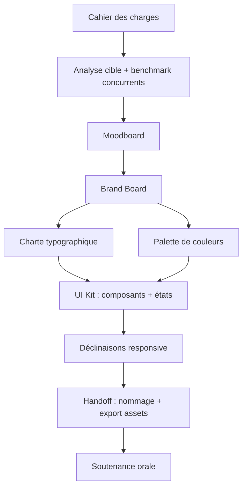

# UI Design : Brand Board, typographie, couleurs, UI Kit, responsive

## Résumé

Le design d'interface (UI) suit une chaîne logique : analyser le client et sa cible, fixer une direction artistique (Moodboard puis Brand Board), définir la typographie et la palette de couleurs, normaliser les composants dans un UI Kit, décliner en mobile/tablette/desktop, puis préparer l'export vers le développeur. Chaque choix visuel se justifie par l'identité de marque, la cible et les règles d'accessibilité (RGAA / WCAG). 

Ici tout le travail se fait dans **Figma** et se termine par une évaluation pratique (1h30) et une soutenance orale (5 à 7 min).

## Schéma : déroulé du travail



## Définitions clés (français / anglais)

| Français | Anglais (terme utilisé dans Figma / CSS) | Définition |
|---|---|---|
| UI | User Interface | Interface utilisateur : l'apparence visuelle (couleurs, polices, boutons) |
| Périmètre métier | Business scope | Type de projet : B2B, B2C, e-commerce, SaaS, institutionnel |
| Attributs de marque | Brand attributes | 3 à 5 adjectifs qui définissent la marque (ex : écoresponsable, innovant, rassurant, premium) |
| Analyse comparative | Benchmark | Étude des codes graphiques des concurrents pour repérer comment se démarquer |
| Planche d'inspiration | Moodboard | Assemblage d'images, textures, ambiances, interfaces, validé avec le client avant la conception détaillée |
| Planche d'identité | Brand Board | Document d'une page : logo et déclinaisons, palette, paires de polices, iconographie, éléments graphiques |
| Association de polices | Font pairing | Choix du duo titres / corps de texte |
| Avec empattements | Serif | Polices à « pieds » : tradition, élégance, crédibilité (Playfair Display, Merriweather) |
| Sans empattements | Sans-Serif | Polices « bâton » : modernité, lisibilité écran (Inter, Roboto, Montserrat) |
| Chasse fixe | Monospace | Identité technique, code (Fira Code, JetBrains Mono) |
| Graisse | Font weight | Épaisseur du trait (Light, Regular, Medium, SemiBold, Bold) |
| Super-famille | Super-family | Police proposant plusieurs graisses |
| Échelle modulaire | Modular scale | Tailles de police issues d'un ratio mathématique (1.250 « Major Third », 1.333 « Perfect Fourth ») |
| Hauteur de ligne | Line-height | Espace vertical entre deux lignes de texte |
| Longueur de ligne | Measure | Nombre de caractères par ligne |
| Interlettrage | Letter-spacing / tracking | Espace entre les lettres |
| Style de texte | Text Style (Figma) | Réglage de texte enregistré et réutilisable |
| Couleur primaire | Primary color | Couleur d'action principale (boutons, liens actifs) |
| Couleur secondaire / d'accent | Secondary / Accent color | Mises en avant, badges |
| Échelle de neutres | Neutral scale | 8 à 10 nuances de gris, du blanc #FFFFFF au noir #0F172A |
| Couleurs sémantiques | Feedback colors | Success (vert), Warning (orange/jaune), Danger/Error (rouge), Info (bleu) |
| Ratio de contraste | Contrast ratio | Rapport de luminosité entre le texte et son fond (ex : 4.5:1) |
| Kit d'interface | UI Kit / Design System | Ensemble de composants réutilisables et cohérents |
| État d'un composant | State | Default, Hover (survol), Focused (focus clavier), Active/Pressed (clic), Disabled (inactif), Error |
| Grille de mise en page | Layout grid | Colonnes + gouttières + marges |
| Gouttière | Gutter | Espace entre deux colonnes |
| Zone tactile | Touch target | Zone cliquable au doigt |
| Mise en page automatique | Auto-Layout (Figma) | Équivalent du Flexbox en CSS |
| Passation au développeur | Handoff | Préparation du fichier pour que le développeur l'intègre |

## Procédure 1 : analyser la demande et la cible

1. Lire le cahier des charges et identifier le périmètre métier (B2B, B2C, e-commerce, SaaS, institutionnel).
2. Définir 3 à 5 adjectifs de marque.
3. Faire le benchmark de 3 concurrents directs : relever leurs codes graphiques (couleurs, polices, ambiance) et repérer les opportunités de démarcation.
4. Vérifier le sens des couleurs choisies par rapport à la cible.

| Couleur | Associations principales |
|---|---|
| Bleu | Calme, confiance, communication |
| Rouge | Vie, passion, amour, danger |
| Jaune | Gaieté, jeunesse, prudence |
| Vert | Nature, croissance, espoir |
| Rose | Féminité, douceur, romantisme |
| Orange | Créativité, vitalité, échange |
| Violet | Luxe, mystère, spiritualité |
| Blanc | Pureté, innocence, élégance |
| Noir | Élégance, mystère, intemporalité |

## Procédure 2 : réaliser le Moodboard

1. Rassembler sur Pinterest ou dans Figma : ambiances photographiques (style, éclairage, cadrage), textures et formes (angles arrondis ou géométrie stricte, ombres portées, aplats), exemples d'interfaces .
2. Choisir 2 déclinaisons d'ambiances (option A et option B).
3. Le faire valider par le client **avant** la conception détaillée (et donc pour l'exo ne garder qu'une option pour la suite).

## Procédure 3 : composer le Brand Board dans Figma

Une seule page, 4 zones :

1. **Zone 1** : identité et logos (fond clair, fond sombre, favicon).
2. **Zone 2** : palette primaire, secondaire et neutres.
3. **Zone 3** : titres et corps de texte (font pairing).
4. **Zone 4** : style des boutons et composants clés.


## Procédure 4 : construire la charte typographique

1. Choisir **2 familles maximum** : une pour les titres, une pour le corps (ex : Poppins + Inter).
2. Créer du contraste : Serif en titre + Sans-Serif en corps.
3. Préférer une super-famille avec plusieurs graisses.
4. Construire l'échelle modulaire (base 16 px, ratio 1.250) :

| Niveau | px | rem |
|---|---|---|
| Caption / Small | 12.8 | 0.8 |
| Body (minimum recommandé) | 16 | 1 |
| H5 / Lead | 20 | 1.25 |
| H4 | 25 | 1.563 |
| H3 | 31.25 | 1.953 |
| H2 | 39.06 | 2.441 |
| H1 | 48.83 | 3.052 |

5. Régler la lisibilité :
   - line-height du corps : 1.4 à 1.6 ; des titres : 1.1 à 1.2
   - longueur de ligne : 45 à 75 caractères
   - letter-spacing : légèrement augmenté en MAJUSCULES, resserré sur les très grands titres
6. Créer les **Text Styles** Figma : Display, H1, H2, H3, H4, Body-Large, Body-Regular, Body-Small, Button-Text, Caption.
7. Rédiger les consignes développeur : tailles en px et rem, graisses, line-height, margin-bottom conseillé.
8. Prévoir une version **OpenDyslexic** pour le mode d'accessibilité renforcée.

### Accessibilité typographique (RGAA)

- Police OpenDyslexic (ou Dyslexie) activable pour les troubles de l'apprentissage.
- Caractères ambigus bien distincts : I majuscule, l minuscule, 1 chiffre.
- **Pas de texte dans une image** : tout texte doit être du vrai texte intégrable en HTML/CSS.

## Procédure 5 : construire la palette de couleurs

1. Couleurs de marque : Primary + Secondary/Accent.
2. Échelle de neutres : 8 à 10 nuances de #FFFFFF à #0F172A.
3. Couleurs sémantiques : Success, Warning, Danger/Error, Info.
4. Tester **chaque** association texte/fond avec le Contrast Checker (https://coolors.co/contrast-checker/), le plugin Figma Stark ou Contrast, ou WebAIM.
5. Ajuster les valeurs HEX/HSL jusqu'à validation.

### Ratios de contraste minimaux (WCAG 2.1 AA)

| Élément | Ratio minimal |
|---|---|
| Texte normal (< 18 pt / 24 px) | 4.5:1 |
| Grand texte (≥ 18 pt / 24 px, ou gras ≥ 14 pt) | 3:1 |
| Composants d'interface et éléments graphiques (boutons, champs) | 3:1 |

**Règle d'or RGAA** : une information importante n'est jamais transmise par la couleur seule ; elle est aussi exprimée par du texte. Un champ en erreur ne devient pas seulement rouge : il porte une icône d'erreur **et** un message explicatif (« Le format de l'email est invalide »).

## Procédure 6 : créer le UI Kit (composants + états)

1. Designer les composants de base :
   - Boutons : Primary, Secondary, Ghost/Outline, Danger
   - Champs : input texte, Select, Checkbox, Radio, Toggle
   - Cards, Badges, Modales
2. Pour le bouton : créer un composant **master** avec variantes (Type, Size, Icon left/right).
3. Configurer systématiquement les états : Default, Hover, Focused, Active/Pressed, Disabled, Error.
4. Le focus clavier est indispensable : il doit être visible.
5. Formulaire d'inscription accessible : champs Nom, Email, Mot de passe, Checkbox CGU, avec états de validation succès/erreur combinant couleur + icône + texte.

Durées de l'atelier : audit de contraste 30 min, boutons 45 min, formulaire 45 min.

## Procédure 7 : décliner en responsive

| Format | Largeur | Grille | Gutters | Marges |
|---|---|---|---|---|
| Desktop | 1440 px et + | 12 colonnes | 24 px | auto ou 80 px et + |
| Tablette | 768 à 1024 px | 8 ou 12 colonnes | 16 px | (non précisé dans le cours) |
| Smartphone | 375 à 430 px | 4 colonnes | 16 px | 16 ou 20 px |

Adaptations des composants :

- Navigation horizontale du header → **menu burger** (menu tiroir).
- Grille de cards multi-colonnes → empilement vertical ou carrousel horizontal.
- Zones tactiles : minimum **44×44 px** ou **48×48 px** sur mobile.

## Procédure 8 : préparer le handoff et exporter les assets

1. Nommer les calques explicitement (ou en BEM) : `Header/Navigation/Btn-Primary`, jamais `Frame 1042`, `Rectangle 12`, `Group 12`.
2. Regrouper en composants ; utiliser l'**Auto-Layout** partout (comportement proche du Flexbox CSS).
3. Exporter :
   - **SVG** : icônes, logos, illustrations plates
   - **WebP, PNG 2x/3x, JPG** : photographies
4. Optimiser le poids des images (TinyPNG ou plugins d'export) pour préserver le temps de chargement.

## Exemple de code commenté : traduire la charte en CSS

```css
/* ===== Variables (« tokens ») issues du Brand Board ===== */
:root {
  /* Couleurs : à valider au Contrast Checker avant usage */
  --color-primary: #1D4ED8;      /* couleur d'action */
  --color-neutral-900: #0F172A;  /* texte */
  --color-neutral-0: #FFFFFF;    /* fond */
  --color-danger: #B91C1C;       /* erreur */

  /* Polices : 2 familles maximum */
  --font-heading: "Poppins", sans-serif;
  --font-body: "Inter", sans-serif;

  /* Échelle modulaire, base 16 px, ratio 1.250 */
  --fs-small: 0.8rem;
  --fs-body: 1rem;
  --fs-h4: 1.563rem;
  --fs-h3: 1.953rem;
  --fs-h2: 2.441rem;
  --fs-h1: 3.052rem;
}

body {
  font-family: var(--font-body);
  font-size: var(--fs-body);   /* 16 px minimum */
  line-height: 1.5;            /* entre 1.4 et 1.6 */
  color: var(--color-neutral-900);
  background: var(--color-neutral-0);
}

h1 {
  font-family: var(--font-heading);
  font-size: var(--fs-h1);
  line-height: 1.15;           /* titres : 1.1 à 1.2 */
}

p {
  max-width: 65ch;             /* longueur de ligne : 45 à 75 caractères */
}

/* Focus clavier visible (état Focused) */
button:focus-visible {
  outline: 3px solid var(--color-primary);
  outline-offset: 2px;
}

/* Zone tactile minimale */
button {
  min-width: 44px;
  min-height: 44px;
}
```

```html
<!-- Champ en erreur : couleur + icône + message texte (règle d'or RGAA) -->
<label for="email">Email</label>
<input id="email" type="email" aria-invalid="true" aria-describedby="email-erreur">
<p id="email-erreur" role="alert">
  <span aria-hidden="true">⚠</span> Le format de l'email est invalide
</p>
```

## Plan de soutenance orale (5 à 7 minutes + questions)

1. Présenter le besoin client et la cible.
2. Justifier les choix typographiques et la palette de couleurs.
3. Démontrer le respect de l'accessibilité (RGAA, contrastes, OpenDyslexic).
4. Expliquer l'adaptation responsive mobile.

## Évaluation pratique (1h30)

Finaliser la maquette d'une page produit/service en **Desktop (1440 px)** et **Mobile (390 px)** :

- [ ] Respect du Brand Board et du UI Kit
- [ ] Fichier Figma rangé : dossiers propres, Auto-Layout, aucun calque « Group 12 »
- [ ] Export du dossier d'assets (.svg et .webp)

## ATTENTION aux erreurs courantes

- Choisir des couleurs « jolies » sans lien avec la marque ni la cible.
- Utiliser plus de 2 familles de polices.
- Corps de texte inférieur à 16 px.
- Vérifier les contrastes uniquement sur le texte et oublier les boutons et champs (3:1).
- Signaler une erreur uniquement en rouge.
- Oublier l'état Focus (navigation au clavier impossible à suivre).
- Mettre du texte dans une image.
- Laisser des noms de calques par défaut (Frame 1042, Group 12).
- Exporter des photos en PNG lourd au lieu de WebP optimisé.
- Zones tactiles trop petites sur mobile.

## Compétences du référentiel visées (grille d'évaluation du module)

| Critère | Indicateur |
|---|---|
| Cr 6.a.1 et 6.a.2 | Brand Board et Moodboard traduisent l'analyse de la cible et des concurrents |
| Cr 6.b.1 | Hiérarchie typographique claire (Display, H1 à H6, Body) |
| Cr 6.b.2 et 1.c.3 | Contrastes WCAG AA ≥ 4.5:1, alternative OpenDyslexic, infos non exclusivement chromatiques |
| Cr 6.c.1 | Fichier rangé, calques nommés, composants master réutilisés |
| Cr 6.c.3 | Assets exportés en SVG / WebP et optimisés |
| Cr 6.d.1 et 6.d.2 | Déclinaison mobile/desktop lisible, zones tactiles respectées |
| Cr 6.a.3 | Argumentation orale claire et structurée |

Bloc du titre concerné : Bloc 4 (design d'interfaces), avec le lien accessibilité du Bloc 1.

## Liens internes

[[Figma - boîte à outils]] · [[Cahier des charges]] · [[Accessibilité RGAA - WCAG]] · [[CSS - variables et typographie]] · [[HTML sémantique]] · [[Responsive design]] · [[Auto-Layout et Flexbox]]
